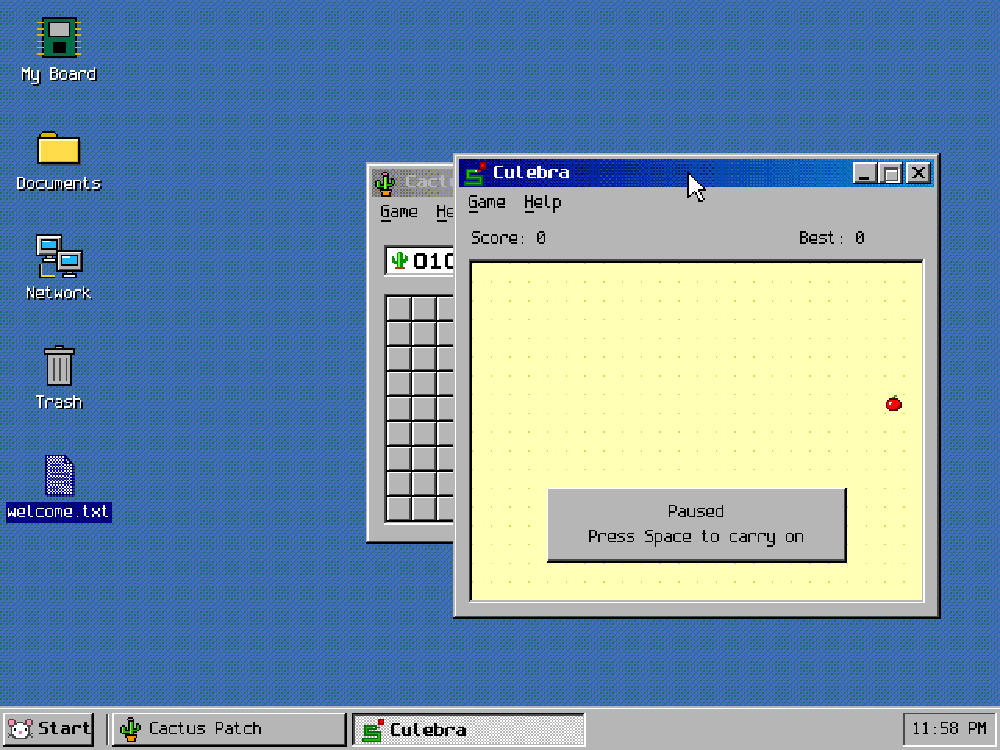
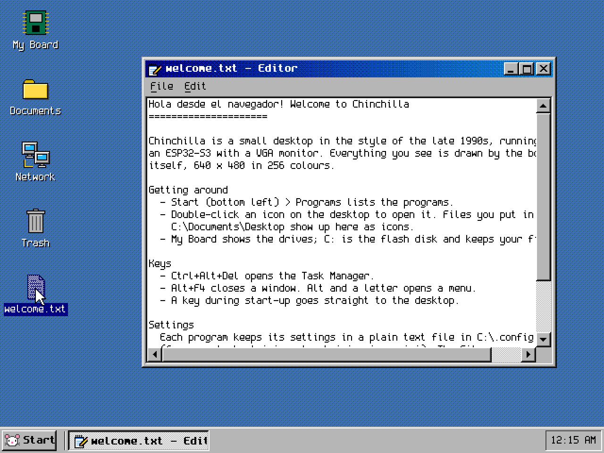

# Chinchilla (esp32-os)


A 90s-style desktop operating environment (think Windows 95/98) for the
ESP32-S3, with VGA output from GPIO pins, Wi-Fi, and USB keyboard and mouse.

Status: **the desktop runs on the board.** Overlapping, resizable windows in
the 98 look with menus, a taskbar with a clock and the Start menu, desktop
icons, widgets, an Editor, a File manager, a Picture viewer (BMP, PNG,
baseline JPEG, GIF) and a drawing program, files on the flash (LittleFS, kept across restarts), a
start-up self-test, plus a debug protocol for screenshots,
injected input and file transfer.

## Try it in the browser

**<https://www.hugochinchilla.net/esp32-os/>**

The same desktop, running in a web page with nothing to install. It needs a
mouse and a keyboard. Files saved on its C: stay in your own browser. It is
built from `main` on every change; how it works is under
[Chinchilla in a web browser](#chinchilla-in-a-web-browser).

## What it will be

- 640x480 at 60 Hz on a VGA monitor, 256 colours, with a mouse cursor that
  always moves at 60 Hz.
- A desktop with taskbar, Start menu, icons and overlapping windows.
- A file system with a file manager, a Notepad-style text editor, and a viewer
  for BMP, PNG, JPEG and GIF images.
- Wi-Fi, with the clock set from NTP, or from an optional battery-backed clock
  chip.
- Vizcacha, a web browser for pages as the 1990s wrote them: no scripts, no
  style sheets, plain HTTP. [FrogFind](http://frogfind.com/) is its way into
  today's web.
- A serial debug protocol (screen capture, injected keyboard and mouse events)
  so the OS can be tested by an agent without a human.
- Remote keyboard, mouse and screen over the network until USB input hardware
  exists.

## Hardware

- ESP32-S3 dev board with 16 MB flash and 8 MB octal PSRAM (ESP32-S3-N16R8,
  DevKitC-1 pin layout, two USB-C sockets).
- An adapter board built on a 5x7 cm perfboard that the dev board plugs into:
  9 colour resistors and 2 sync resistors for VGA, an audio output filter for a
  3.5 mm jack, and a beeper.


See [docs/hardware/README.md](docs/hardware/README.md) for the pin map, the
resistor values and build notes.

## Repository layout

| Path | Contents |
| --- | --- |
| `docs/DECISIONS.md` | The index of what has been decided, what was rejected, and what is still open: what always applies, and one line per decision |
| `docs/decisions/` | One file per decision, listed in the index by `tools/decisions_index.py` |
| `docs/hardware/` | VGA adapter pin map, resistor values and board diagram |
| `docs/debug-protocol.md` | The serial protocol for screenshots and injected input |
| `docs/benchmark.md` | How to run the 60 fps benchmark again and read its results |
| `core/` | The portable part of the OS (C++). Depends on no hardware; builds for the board and for a PC |
| `firmware/os/` | The OS firmware: ESP-IDF project with the ESP32 adapters for `core/` |
| `firmware/vga-test/` | ESP-IDF test program for the VGA wiring |
| `host/` | PC build: unit tests and picture tests for `core/`, a simulated board, and `desktop/`, Chinchilla as a desktop program for Linux |
| `third_party/` | Freely licensed files from elsewhere: the Spleen font; the engine of Doom (GPL 2), which is part of `programs/doom` only |
| `web/` | Chinchilla in a web browser: the Emscripten build of `host/desktop/` and its page |
| `ci/` | GitHub Actions workflows to copy into `.github/workflows/`: the build, publishing the browser version on GitHub Pages, and deploying its relay to Cloudflare |
| `tools/` | `dbg.py`, the debug tool; `check_pictures.py`, the picture tests; `gen_font.py`, the font table generator; `mockup/`, the script that drew the target look; the setup script for Arch-based systems; the script that regenerates the board diagram |

## Tests on the PC

No board needed. Requires CMake, a C++ compiler, Python 3 and pyserial.

```sh
cmake -S host -B build/host
cmake --build build/host
ctest --test-dir build/host --output-on-failure
```

`build/host/sim` is a simulated board: it prints a port name that
`tools/dbg.py --port <name>` can talk to. `build/host/sim <folder>` also shows
that folder of the PC as drive D:.

The picture tests draw the desktop through a series of steps and compare
each screen with `host/tests/pictures/`. After an intended change to the
look, regenerate them, look at every changed picture, and commit them:

```sh
python3 tools/check_pictures.py build/host/render_scenes --update
```

The font table `core/src/gfx/font_spleen6x12.cpp` is generated:
`python3 tools/gen_font.py third_party/fonts/spleen/spleen-6x12.bdf core/src/gfx/font_spleen6x12.cpp`.

## The command shell on a PC

Chinchilla's command shell (`dir`, `ls`, `type`, `copy`, `ps`, `kill`...) in
a terminal of the PC. It is the same code that will run on the board's serial
port and in a terminal window; here the PC's terminal is the device. Needs
only CMake and a C++ compiler.

```sh
cmake -S host -B build/host && cmake --build build/host --target chinchilla-console
build/host/chinchilla-console                 # C: is a RAM disk with the sample files
build/host/chinchilla-console ~/some/folder   # that folder is C:, for real
```

`help` lists the commands. The line editing, the up arrow and Ctrl+C are
Chinchilla's own, not the PC's. Ctrl+D or `exit` leaves.

## Chinchilla as a desktop program (Linux)

The same `core/` in a window on a PC: the window is the monitor, the PC's
mouse and keyboard are the board's, and a folder of the PC is drive C:. For
trying programs without flashing, and for showing Chinchilla to someone with
no board. It is not an emulator of the ESP32: no memory limits, no real
Wi-Fi, and far faster than the board, so it says nothing about speed, RAM or
the colours on a real monitor.



Needs CMake, a C++ compiler and SDL2 with its headers:

| System | Install |
| --- | --- |
| Arch, Omarchy | `sudo pacman -S --needed cmake gcc make sdl2` (on a current Arch this installs `sdl2-compat`) |
| Debian, Ubuntu | `sudo apt install cmake g++ make libsdl2-dev` |
| Fedora | `sudo dnf install cmake gcc-c++ make SDL2-devel` |

```sh
cmake -S host -B build/desktop -DHOST_SANITIZE=OFF -DCMAKE_BUILD_TYPE=Release
cmake --build build/desktop --target chinchilla
build/desktop/chinchilla
```

The result is one file of about 1 MB, `build/desktop/chinchilla`. It runs on
another Linux PC with the same kind of processor that has SDL2 installed
(most desktops do).

| Option | What it does |
| --- | --- |
| `--drive FOLDER` | The folder that is drive C:. Default `~/.local/share/chinchilla/C`. A new, empty folder gets the sample files. They are ordinary files: copy a picture in from Linux and the File manager shows it |
| `--fast` | No start-up screens (a key or a click also skips them) |
| `--scale N` | Open the window at N times 640x480. Default: the largest of 1, 2, 3 that fits the desktop |
| `--fullscreen` | Start on the whole screen |
| `--mute` | No sound. Without it the self-test ends in a beep, the desktop comes up with a chime and message boxes knock, through the PC's sound card |

In the window:

- The window can be any size. The picture keeps its 4:3 shape, with black
  bars where it does not fill the window.
- F11 switches between the window and the whole screen. F12 saves a picture
  of the window as `chinchilla-001.bmp`, `-002` and so on in the folder the
  program was started from.
- Ctrl+Alt+End is Chinchilla's Ctrl+Alt+Del (Linux keeps the real one), and
  Ctrl+Esc opens the Start menu if the desktop keeps the Super key (which
  also means Super+D, Chinchilla's "show the desktop", may not arrive).
- Keys type what a US keyboard would: the core has no other layouts yet,
  the same as on the board.
- Closing the window shuts Chinchilla down: programs are asked to close, so
  the Editor still asks about unsaved text. Closing it again within three
  seconds leaves at once.
- There is no sound: the system does not make any yet, on the board either.

`build/host/chinchilla`, built along with the tests when SDL2 is installed,
is the same program with the memory checks on: some ten times larger, and
slower.

## Chinchilla in a web browser

The desktop program again, built to WebAssembly: a page that anyone can open,
with nothing to install. The page is the monitor, C: is kept in the visitor's
own browser (nothing is sent anywhere), and it comes back on the next visit.
It needs a mouse and a keyboard; it is not made for phones.



Needs [Emscripten](https://emscripten.org/docs/getting_started/downloads.html)
(tested with 7.0.0) and CMake. Emscripten downloads its own SDL2 the first
time.

```sh
emcmake cmake -S web -B build/web
cmake --build build/web
python3 -m http.server -d build/web/site 8080    # then open http://localhost:8080/
```

The result is one file, `build/web/site/index.html` (about 1.7 MB, 0.6 MB as
web servers send it). Put it on any web server, or send the file itself: it
also works opened straight from a folder.

To publish it on GitHub Pages on every change to `main`, copy
`ci/github-pages-workflow.yml` to `.github/workflows/pages.yml` and choose
Settings > Pages > Source: "GitHub Actions". The address is then
`https://<owner>.github.io/<repository>/`.

The page reaches the web through a relay, because a page may not open
connections of its own: `web/relay/README.md` says how to put it on
Cloudflare and give the page its address.

The page starts switched off, with a power button: a browser plays no sound
on a page nobody has clicked, and the self-test's beep and the welcome chime
are the first things the machine does.

What differs from the desktop program: the browser keeps some keys for itself
(Ctrl+W, Ctrl+T, F5, F11 and others; Ctrl+Alt+End is still Ctrl+Alt+Del),
Restart loads the page again, and in a private window C: lasts only until
the page is closed. `tools/test_web_page.js` drives the page in a real
browser (Node and Playwright).

## Building the VGA test

Needs [ESP-IDF](https://docs.espressif.com/projects/esp-idf/en/stable/esp32s3/get-started/)
v5.5. On Arch-based systems (including Omarchy), `tools/setup-arch.sh` installs
it together with the build tools and gives your user access to serial ports
without sudo. Log out and back in afterwards, then run `get_idf` in each new
terminal.

```sh
cd firmware/vga-test
idf.py set-target esp32s3
idf.py -p <serial port> flash monitor
```

Plug the computer into the USB-C socket marked UART (or COM). Details and the
keys that switch modes are in
[firmware/vga-test/README.md](firmware/vga-test/README.md).
