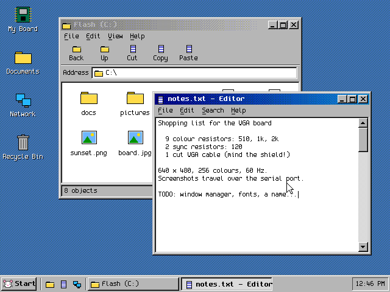
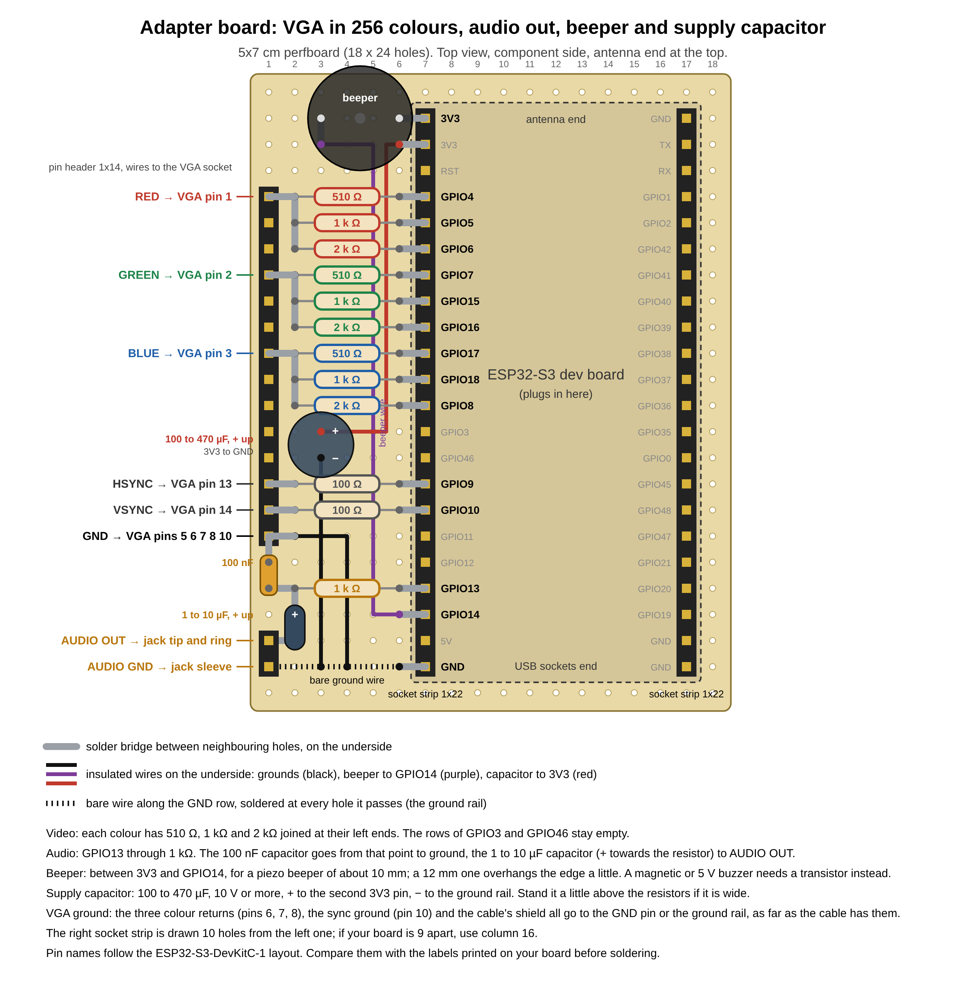

# Chinchilla (esp32-os)



A 90s-style desktop operating environment (think Windows 95/98) for the
ESP32-S3, with VGA output from GPIO pins, Wi-Fi, and USB keyboard and mouse.

Status: **the desktop runs on the board.** Overlapping, resizable windows in
the 98 look with menus, a taskbar with a clock and the Start menu, desktop
icons, widgets, an Editor, a File manager and a Picture viewer (BMP, PNG,
baseline JPEG), files on the flash (LittleFS, kept across restarts), a
start-up self-test and splash, plus a debug protocol for screenshots,
injected input and file transfer.

## What it will be

- 640x480 at 60 Hz on a VGA monitor, 256 colours, with a mouse cursor that
  always moves at 60 Hz.
- A desktop with taskbar, Start menu, icons and overlapping windows.
- A file system with a file manager, a Notepad-style text editor, and a viewer
  for BMP, PNG and JPEG images.
- Wi-Fi, with the clock set from NTP, or from an optional battery-backed clock
  chip.
- A serial debug protocol (screen capture, injected keyboard and mouse events)
  so the OS can be tested by an agent without a human.
- Remote keyboard, mouse and screen over the network until USB input hardware
  exists.

## Hardware

- ESP32-S3 dev board with 16 MB flash and 8 MB octal PSRAM (ESP32-S3-N16R8,
  DevKitC-1 pin layout, two USB-C sockets).
- An adapter board built on a 5x7 cm perfboard that the dev board plugs into:
  9 colour resistors and 2 sync resistors for VGA, an audio output filter for a
  3.5 mm jack, and a beeper.



See [docs/hardware/README.md](docs/hardware/README.md) for the pin map, the
resistor values and build notes.

## Repository layout

| Path | Contents |
| --- | --- |
| `docs/DECISIONS.md` | What has been decided, what was rejected, and what is still open |
| `docs/hardware/` | VGA adapter pin map, resistor values and board diagram |
| `docs/debug-protocol.md` | The serial protocol for screenshots and injected input |
| `core/` | The portable part of the OS (C++). Depends on no hardware; builds for the board and for a PC |
| `firmware/os/` | The OS firmware: ESP-IDF project with the ESP32 adapters for `core/` |
| `firmware/vga-test/` | ESP-IDF test program for the VGA wiring |
| `host/` | PC build: unit tests and picture tests for `core/`, and a simulated board |
| `third_party/` | Freely licensed files from elsewhere: the Spleen font |
| `ci/` | GitHub Actions workflow to copy into `.github/workflows/` |
| `tools/` | `dbg.py`, the debug tool; `check_pictures.py`, the picture tests; `gen_font.py`, the font table generator; `mockup/`, the script that drew the target look; the setup script for Arch-based systems; the script that regenerates the board diagram |

## Tests on the PC

No board needed. Requires CMake, a C++ compiler, Python 3 and pyserial.

```sh
cmake -S host -B build/host
cmake --build build/host
ctest --test-dir build/host --output-on-failure
```

`build/host/sim` is a simulated board: it prints a port name that
`tools/dbg.py --port <name>` can talk to. `build/host/sim <folder>` also shows
that folder of the PC as drive D:.

The picture tests draw the desktop through a series of steps and compare
each screen with `host/tests/pictures/`. After an intended change to the
look, regenerate them, look at every changed picture, and commit them:

```sh
python3 tools/check_pictures.py build/host/render_scenes --update
```

The font table `core/src/gfx/font_spleen6x12.cpp` is generated:
`python3 tools/gen_font.py third_party/fonts/spleen/spleen-6x12.bdf core/src/gfx/font_spleen6x12.cpp`.

## Building the VGA test

Needs [ESP-IDF](https://docs.espressif.com/projects/esp-idf/en/stable/esp32s3/get-started/)
v5.5. On Arch-based systems (including Omarchy), `tools/setup-arch.sh` installs
it together with the build tools and gives your user access to serial ports
without sudo. Log out and back in afterwards, then run `get_idf` in each new
terminal.

```sh
cd firmware/vga-test
idf.py set-target esp32s3
idf.py -p <serial port> flash monitor
```

Plug the computer into the USB-C socket marked UART (or COM). Details and the
keys that switch modes are in
[firmware/vga-test/README.md](firmware/vga-test/README.md).
