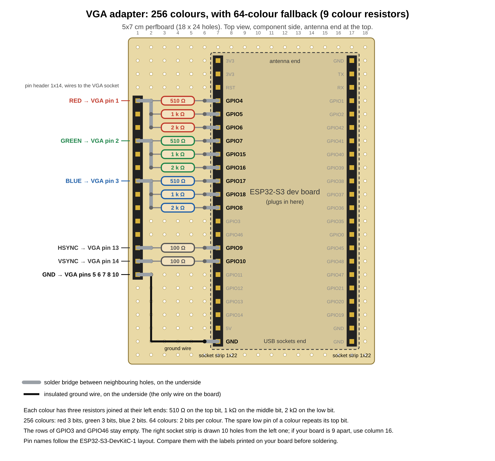

# VGA adapter

A carrier board on 5x7 cm perfboard (18 x 24 holes). The dev board plugs into
two 1x22 socket strips, and each resistor sits in the row of its own GPIO pin,
so the only wire on the board is ground.

Regenerate the drawing with `python3 tools/gen_vga_adapter_diagram.py` from the
repository root (writes the SVG).

## Pin map

| Signal | GPIO | Resistor | Data bus bit |
| --- | --- | --- | --- |
| Red, top bit | 4 | 510 ohm | D7 |
| Red, middle bit | 5 | 1 k | D6 |
| Red, low bit | 6 | 2 k | D5 |
| Green, top bit | 7 | 510 ohm | D4 |
| Green, middle bit | 15 | 1 k | D3 |
| Green, low bit | 16 | 2 k | D2 |
| Blue, top bit | 17 | 510 ohm | D1 |
| Blue, middle bit | 18 | 1 k | D0 |
| Blue, low bit | 8 | 2 k | copy of D1 |
| HSYNC | 9 | 100 ohm | |
| VSYNC | 10 | 100 ohm | |

The three resistors of one colour join at their far ends and go to the VGA
connector. Peak level into the monitor's 75 ohm input is about 0.68 V.

A pixel is one byte, `RRRGGGBB`, clocked straight onto D7..D0. Blue has only
two bits in the byte, so its third pin repeats blue's top bit. That gives blue
the levels 0, 2/7, 5/7 and 7/7, which keeps white neutral and gives four exact
greys.

## VGA connector (15-pin)

| Connector pin | Signal |
| --- | --- |
| 1 | Red |
| 2 | Green |
| 3 | Blue |
| 13 | HSYNC |
| 14 | VSYNC |
| 5, 6, 7, 8, 10 | Ground |

## Reserved and spare pins

| Use | GPIO |
| --- | --- |
| USB host data (fixed by the chip) | 19, 20 |
| Debug UART (USB-C socket marked UART) | 43, 44 |
| Clock chip on I2C: SDA, SCL | 1, 2 |
| SD card: CLK, CMD, D0 | 12, 11, 13 |
| USB power switch enable and fault, optional | 14, 21 |
| Spare | 38 to 42, 47, 48 (one of 38 or 48 is the on-board LED) |
| Not used: boot strapping pins | 0, 3, 45, 46 |
| Not available: flash and PSRAM | 26 to 37 |

## Before soldering

- Pin names follow the official ESP32-S3-DevKitC-1. Compare them with the
  labels printed on your board.
- The drawing puts the socket strips 10 holes apart. Some boards are 9 apart,
  so test-fit the dev board on the perfboard first.
- A VGA socket's staggered pins do not fit perfboard holes. The drawing ends at
  a pin header; wire it to a solder-cup socket, a breakout or a cut cable.
- 1/4 W resistors are far more than needed (the worst case is about 16 mW).
  Prefer 1% parts.
