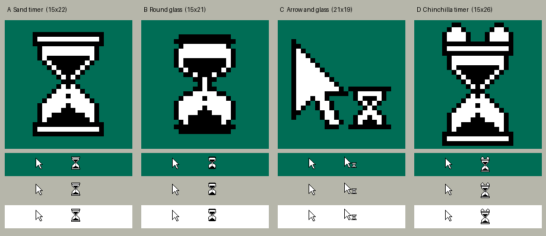
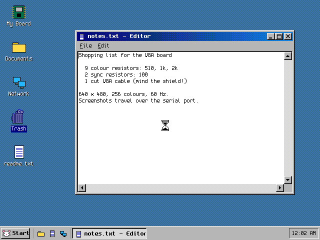

# 2026-11-16: Saves that cannot lose the document, and the hourglass

Backlog items 6 (atomic saves) and 6b (the hourglass pointer), built on the
branch `claude/project-thread-2xsa54`. Tested on the PC only. The firmware has
not been compiled with this change and nothing here has run on the board; what
the board must confirm is listed in section 7.

Code references are to `main` at commit `384a63b`.

## 1. What was asked

The two items come from the architecture review
([journal](2026-11-16-architecture-review.md), sections 2 and 4). The review
found that a save empties the file first and then writes it, and proposed a
temporary file and a rename. The owner approved the list and added the
hourglass himself:

> La de que el guardado bloquee durante un tiempo, incluso me hace ilusión para
> poder añadir el reloj de arena en el cursor, que es otra de esas cosas que no
> recordaba de esos tiempos, y en cuanto he leído sobre ello me ha hecho tener
> mucha nostalgia y quiero volver a verlo.

So the freeze during a save, which the review listed as a defect, is for now
also a feature: it is the reason to show an hourglass. The freeze goes away
with backlog item 10 (saves as jobs on a worker task); the hourglass stays, for
the window that is busy.

## 2. What was found

**The save.** `EditorWindow::save()` in `core/src/shell/editor.cpp` opened the
document with `OpenMode::Write`, which means "create, or empty an existing
file", and then wrote the text 1024 bytes at a time. From the first instant of
the save the old document no longer existed. The review measured a 293 KB save
at 3.3 seconds on the board, so for 3.3 seconds a power cut, a reset or a full
disk left a file with half the text, or none.

**The settings files already knew.** `fs::Ini::save()` wrote
`<name>.ini.tmp`, removed the old file and renamed the new one into place, with
this comment: "no rename-over on every drive, so remove then rename; a cut in
between leaves the .tmp file, which load() reads". It had the right idea and a
gap: between the remove and the rename there is no file under the real name.
`load()` covered the gap by reading the `.tmp` file as well.

**Why there was no "rename over".** `ports::Volume::rename()` refuses when the
new name exists (`FsError::Exists`), in both drives: the RAM disk
(`MemoryVolume`) and the POSIX one (`PosixVolume`, which is the PC folder in the
simulator and LittleFS on the board). That is right for the File manager's
Rename command, which must not destroy a file by accident. It left no way to
ask for the replacement on purpose.

**What LittleFS offers.** Its `lfs_rename()` replaces the destination as a
single change to the file system's log: after a power cut the name points to
the old file or to the new one, never to neither and never to a mixture. The
ESP-IDF wrapper the board uses (joltwallet/littlefs 1.23.1,
`vfs_littlefs_rename`) passes the call straight through; it only refuses when
either file is open. This was read in the component's source, not run.

**The pointer.** The pointer is never painted into the picture. The video
interrupt mixes it into each line on its way to the monitor
(`video::compose_pointer`, `firmware/os/main/main.cpp`). That decision was made
for speed, and it turns out to be what makes an hourglass possible at all in a
system with one UI task: while the Editor is inside `save()` nothing can paint,
but the interrupt keeps running and picks the new shape up at the next frame.
The window manager already switched shapes for the resize arrows
(`Wm::update_pointer_shape`), so there was a place for one more.

## 3. The options considered

### How to make a save safe

| Option | What it costs | Verdict |
| --- | --- | --- |
| **Temporary file, then rename over the original** | Room for two copies of the document until the last step. One new operation in the drive interface | **Chosen** (the review's proposal, approved by the owner) |
| Remove, then rename (what the settings files did) | Nothing new in the drives | No: there is a moment with no file under the real name, and every reader has to know to look for the `.tmp` |
| Copy the old file to a backup (`notes.bak`) and then write in place | Twice the flash writes on every save, and a backup file next to every document | No: slower, wears the flash twice as fast, and after a cut the user has to know the backup exists. It was common in the 90s, and it could come back as an option |
| Write in place and trust the file system | Nothing | No: LittleFS keeps *itself* consistent across a power cut, but the file had already been emptied on purpose. The file system cannot know the old contents still mattered |

### Where the temporary file lives and what it is called

| Option | Verdict |
| --- | --- |
| **Hidden, beside the document: `.~notes.txt.tmp`** | **Chosen, to confirm.** The same folder means the same drive, which a rename needs. A name starting with a dot is already hidden in folder windows and on the desktop, so a save does not make a file blink in and out of an open folder. `.tmp` at the end keeps the name valid when a long name is cut (names may not end in a dot or a space); 57 of the 63 characters are kept |
| Visible, beside the document: `notes.txt.tmp` or `~notes.txt` | No: it would appear in the folder window during each save. `~$name` is also what Word did, and looks like it |
| One folder for all of them, `C:\.tmp` | No: two documents with the same name in different folders would collide, and it only works on C: |

### How much uses it

| Option | Verdict |
| --- | --- |
| **Every whole-file write (`Storage::write_file`) and the Editor** | **Chosen, to confirm.** The settings files had the same weakness, and now get the same cure with less code than they had |
| The Editor only | No: it would leave two ways of saving in the code, one of them with a known gap |

### The hourglass: the drawing

Four drawings were made, all original, at the size and in the two colours the
pointer has (black, white and see-through; the arrow is 12x19). The sheet is
`docs/look/hourglass-options.png`, drawn by
`tools/mockup/hourglass_options.py`.

| Option | Verdict |
| --- | --- |
| **A, Sand timer** (15x22): straight glass between two flat caps | **Chosen by the owner** on 2026-11-16. It reads as an hourglass at real size on the desktop, on window grey and on white |
| B, Round glass (15x21): two round bulbs | Not chosen. Softer, but at real size the bulbs close up and it reads less clearly |
| C, Arrow and glass (21x19): the arrow keeps pointing, a small hourglass beside it | Not chosen. The glass is 9 pixels and hard to read. It also says "busy, but you can still click", which is not true today: the desktop really is frozen during a save. It is the right pointer for backlog item 10, when only one window is busy |
| D, Chinchilla timer (15x26): the sand timer with a chinchilla's ears | Not chosen. The ears read as a frog's at this size |

### The hourglass: when it shows

| Option | Verdict |
| --- | --- |
| **For every save and every load in the Editor, however short** | **Chosen, to confirm.** No guessing how long something will take. A short save flashes the hourglass for a frame or two, as it did in the 90s |
| Only when the work has already taken some time (say 200 ms) | No, for now: nothing can run "after 200 ms" while the UI task is inside the save. It becomes possible with the worker task of item 10 |
| Animated (the sand falling) | Not now. The UI task cannot animate it while it is busy; the video interrupt could, by counting frames. Kept as an idea |

## 4. What was built

**A new operation in the drive interface.** `ports::Volume::replace(from, to)`
(`core/include/core/ports.hpp`): the file `from` takes the name `to` in one
step, over a file already there. `rename()` keeps refusing an existing name.

- `PosixVolume::replace` calls POSIX `rename()`, which has exactly this
  meaning, after checking that neither side is a folder. On the board that
  reaches `lfs_rename()`.
- `MemoryVolume::replace` hands the new contents to the old file's entry, so
  the file keeps its place in the folder and its name as written.

**Safe saves in `fs::Storage`** (`core/include/core/fs/fs.hpp`):
`begin_save(path, save)` opens the temporary file, the program writes to
`save.file`, and `finish_save(save)` closes it and swaps it in.
`finish_save(save, false)` gives up and removes the temporary file; a failed
close or swap removes it too. `path::temporary()` makes the name.
`write_file()` is now built on these.

**The Editor** saves through `begin_save` / `finish_save`. When a write fails
it gives up, reports the error as before, and the document on the disk is the
last good save.

**The settings files.** `Ini::save()` is one line now (`write_file`). `load()`
still reads an old `<name>.ini.tmp`, in case a board was cut off by the old
code.

**The hourglass.** `video::busy_pointer()` in
`core/src/video/pointer_shapes.cpp`, with its hotspot at the neck of the glass.
`Wm::begin_wait()` and `Wm::end_wait()` count the programs that are making the
user wait, and `update_pointer_shape()` shows the hourglass while the count is
above zero, ahead of the resize arrows. Programs use the small `wm::Wait`
object, which starts the wait when it is created and ends it when it goes out
of scope, so no path through the code can leave the hourglass on. The Editor
holds one around its save loop and its load loop.

## 5. How it was tested

On the PC, 20 of 20 test programs pass
(`ctest --test-dir build/host`). New checks:

- `test_fs`: `replace()` on both kinds of drive (over a file, onto a free
  name, folders refused, a missing source). A save given up half way leaves the
  old contents and no temporary file. A save kept replaces them. A 40,000 byte
  save over a 25,000 byte file on a 64 KB RAM disk fails with "disk full" and
  the old file is intact, byte for byte. Temporary names for short names, the
  longest name and a drive root.
- `test_wm`: the pointer is the hourglass during a wait, stays so when the
  mouse moves over a window edge, waits nest, and the right shape returns.
- `test_shell`: the Editor's drive has a spy in front of it. Every write of a
  save happened with the hourglass up, and the arrow was back afterwards. A
  save whose second write fails leaves the previous text on the disk, no
  temporary file, an error message, and the changes still in the Editor.
- A new reference picture, `39-editor-saving-hourglass`, with the pointer
  mixed in the way the monitor shows it.

Not tested: anything on the board. The firmware was not compiled in this
session (no file under `firmware/` changed; the board build compiles the same
`core/` sources).

## 6. What was learned

- **A decision made for speed paid for a feature.** Mixing the pointer in at
  scanout was chosen so that moving the mouse costs nothing. It is also the
  only reason a single-task desktop can show an hourglass while it is frozen.
  Many video cards of the 90s had a hardware cursor that worked the same way.
- **"Atomic" is a promise the file system makes, and the program has to ask
  for it.** LittleFS is power-safe, and the Editor still lost documents,
  because emptying a file is a perfectly valid, perfectly safe request.
- **The price is disk space.** A save needs room for the old and the new copy
  at once. With a 512 KB limit per document and 11 MB free that is far away,
  but a nearly full disk will now refuse a save that would have fitted
  before. It refuses cleanly: the old document stays.
- **A bug found by the new test.** After a save, typing again did not bring
  the star back in the title ("notes.txt*"), because the Editor remembered the
  star as still shown. It only affected the title; "do you want to save the
  changes?" was still asked. Fixed in `retitle()`. No test had typed after a
  save and looked at the title.
- **The pointer does not move during a save.** The hourglass appears where the
  pointer was, and stays there: mouse events are handled by the same task that
  is saving. That is how it felt at the time, too.

## 7. What is left

For the board turn:

1. Build and flash. Save a small file and a large one (about 300 KB) from the
   Editor. The hourglass appears for the length of the save and the arrow
   returns. Note how long each save takes now: the rename is one more flash
   operation, and `set_shape()` waits for a frame boundary twice (up to about
   35 ms in all).
2. The picture stays stable while the hourglass is up and flash is being
   written (no shifted bands).
3. The file reads back whole, and no `.~*.tmp` is left in the folder (File
   manager with hidden files shown, or `tools/dbg.py`).
4. Cut the power, or reset the board, in the middle of a large save. After the
   restart the document is the previous version, whole. A hidden
   `.~name.tmp` may be left behind; that is expected.
5. Change a setting (the dithering in the Picture viewer), restart, and it is
   kept: the settings files go through the same path.
6. A VNC viewer shows the hourglass too, or at least the arrow again after the
   save.

Left for later, not on the backlog yet:

- A temporary file left by a power cut stays, hidden, until that document is
  saved again. A sweep at start-up could remove them.
- The hourglass for other slow work: the Defragmenter, the Picture viewer's
  first decode, copying in the File manager.
- An animated hourglass, driven by the frame count in the video interrupt.
- Pointer C (arrow with a glass) for a window that is busy while the rest of
  the desktop is not, when item 10 arrives.
