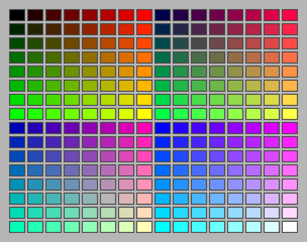
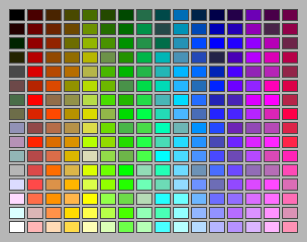
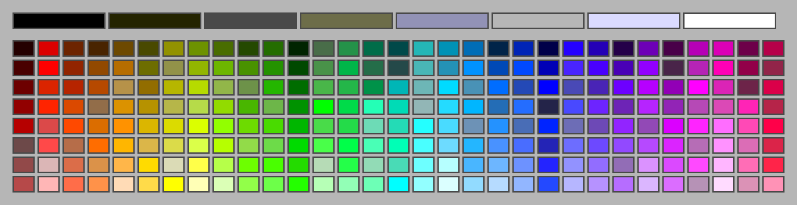
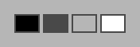
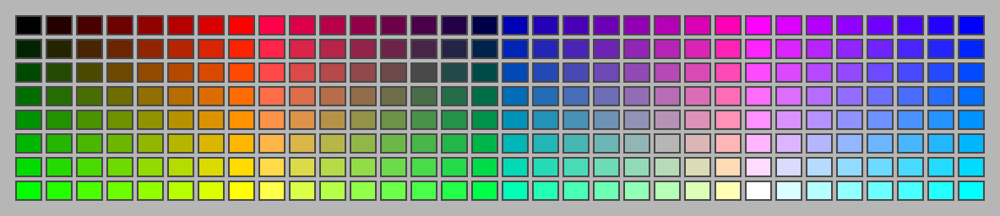
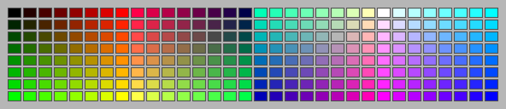
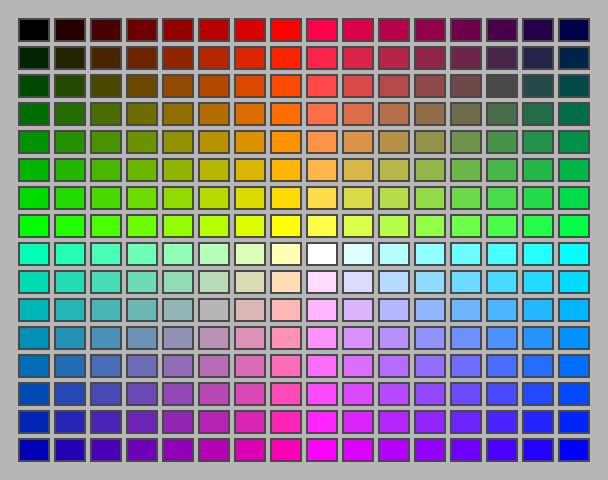
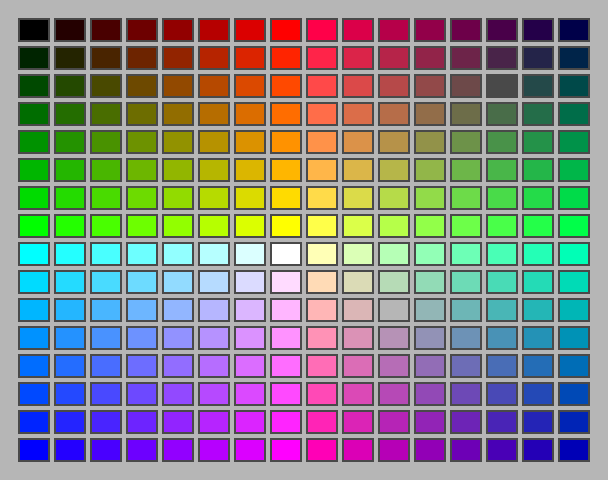
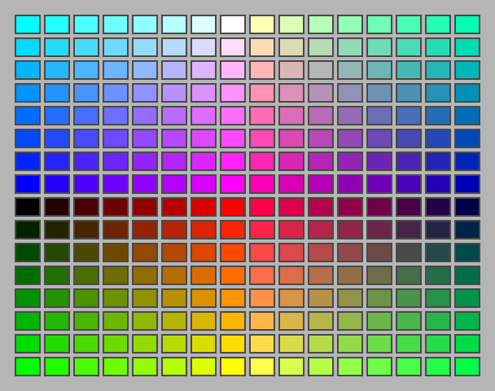
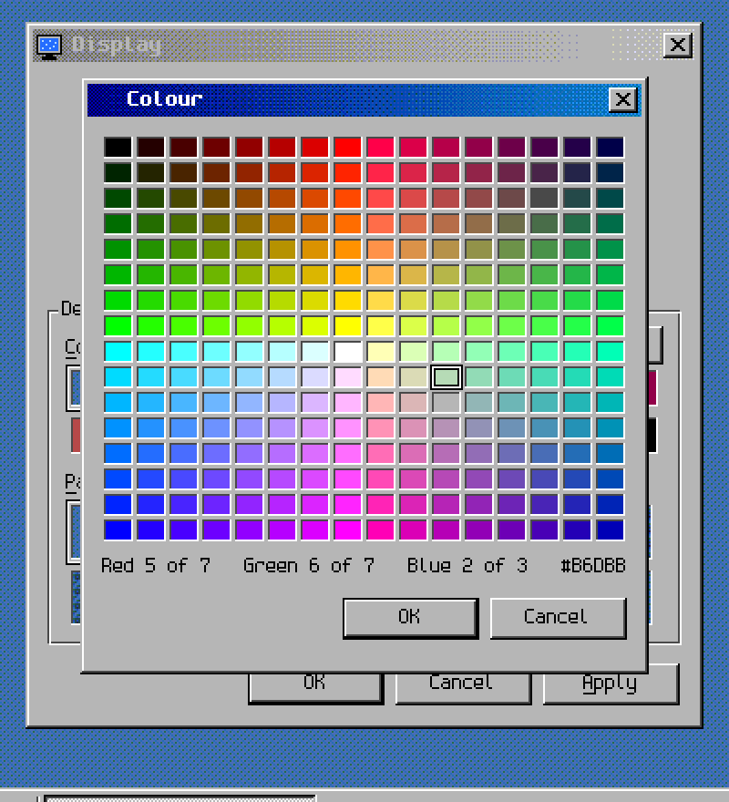

# 256 colours on one sheet

2026-11-17, late morning. PC only; the firmware was not compiled for this
and nothing here has run on the board.

The owner asked for this to be written down for the film: "document this
process of making a color chooser for the video, the different arrangement
options was an interesting thing". It took seven pictures and twenty
minutes of talk to place 256 squares. The pictures are in
`docs/look/colour-chooser/`, drawn by `tools/mockup/colour_layouts.py`
with the colours the board really shows.

## Where it started

The second review round asked that Display offer "any color of the 256
possible colors" (`2026-11-17-review-round-2.md`). The board keeps a colour
in one byte: three bits of red, three of green, two of blue. So red and
green have eight levels and blue has four, and 8 x 8 x 4 = 256.

A colour is three numbers and a screen has two directions. That is the
whole difficulty: a cube must be laid flat.

## 1. Four squares

The first try followed the byte. One square of 8 by 8 for each level of
blue; in a square, red grows to the right and green downwards. It was
built, tested and sent.

The owner:

> whats the logic behind the color chooser alignment of colors? I've never
> seen one like this

A fair question. It is how the machine keeps the colours, not how anybody
looks for one. Each square is a clean gradient, but the four are strangers
to one another: the right edge of the first is red and yellow, the left
edge of the second is navy and green.

## 2. By hue

What other choosers do: the rainbow from left to right, dark to light
downwards, greys in a column at the side. Drawn as a preview before any
code.

It did not survive being looked at, and the agent that had recommended it
said so with the picture. 256 colours do not fill a rainbow evenly: the
columns are patchy, and the "grey" column is not grey.

The owner:

> If you separate the perfect gray levels on a separate strip this would
> make sense

## 3. A strip of greys

Eight steps of grey on a strip, the rest in 31 hues. Half the strip leans
olive or lavender.

> I meant the neutral grays, I see grays with a tint in that bar. How many
> neutral grays do we have on 256 colours?

Four.

A neutral grey needs red, green and blue equal. Red and green have the
levels 0, 36, 73, 109, 146, 182, 219, 255; blue has 0, 73, 182, 255. They
meet four times: black, 73, 182, white. Every other grey on this machine
has a blue a little too low or too high. That is also why the desktop's
own grey is exactly 182.

## 4. One sheet, 32 by 8

Then the owner turned it round:

> somehow the original palette shows 4 nice gradients to the eye, just I
> can't figure out the logic behind them, but they look nice and sorted.
>
> If we could get the same perfect gradient but once and for all colors at
> once I would be delighted

So not a new order: the first one, mended. The four squares fail only at
their edges. Put them in a row and let red run back to the left in every
other square, and each square starts where the one before it ended.

Every cell is now one step of one colour away from each of its neighbours,
the whole way across. (It is the trick of a Gray code: count so that one
thing changes at a time.) It was built. It is also 590 pixels wide on a
screen of 640.

## 5. Folding it

> If you split this horizontally in half and invert the right part (bottom
> to top) I think it would look like a choherent gradient

Three readings of that sentence were drawn.

Side by side, the right half upside down: the halves no longer meet. Dark
navy beside bright mint.

The left half on top and the right half under it, upside down; and the
same with the lower half also mirrored. Both are square again, 16 by 16,
and both read as one sheet: dark at the top, the light colours across the
middle, blue at the bottom.

> this looks better, the bottom right render is almost perfect.
>
> Lets try one thing, split it in half vertically and place the top part at
> the bottom

## 6. The halves swapped

Light at the top, greens at the bottom. On the right the middle joins
(magenta into red). On the left it cannot: pure blue lies on black.

The choice went on a card. The owner tapped the swapped one, and then:

> wait, I clicked on accident

> I think I like 3 more

"3" was the folded and mirrored sheet. That is what the dialog has.

## What was chosen, and why

The folded and mirrored sheet (picture 5c):

- Red grows to the right in the left half and back in the right half.
- Green grows downwards in the upper half and back up in the lower half.
- Blue goes round the four squares: none top left, a little top right,
  more bottom right, full bottom left.

Why it works: across the sheet and down it, a step into the next square
changes only blue, except at the fold in the middle, where blue jumps
(none to full on the left, one step on the right). But at the fold green
is at its brightest on both sides, so the jump is between two light rows
and the eye passes over it. In the swapped sheet the same jump fell
between blue and black.

Why not the others:

- Four squares: no order between the squares.
- By hue, with or without a grey strip: 256 colours are too few and too
  uneven for a rainbow; and there are four greys, not a strip of them.
- 32 by 8: perfect, and nearly the width of the screen.
- The swapped fold: one hard edge.

Under the sheet the dialog says the levels and the `#RRGGBB` the board
shows, so the logic the owner asked about is on the screen.

## A dialog for any program

> oh, and make the color chooser a separate app any program could invoke
> (like the file chooser dialog) to pick a color

It had been built inside Display's file. It is now `colour_dialog()` in
`core/src/shell/colour_dialog.cpp`, beside the file dialogs in
`core/shell/shell.hpp`:

    void colour_dialog(wm::Window *owner, gfx::Colour start, ColourFn chosen, void *context);

Modal to the window that asks, opens on `start`, calls `chosen` with the
board colour on OK and nothing on Cancel. Made when asked for and gone
when closed, so two programs can each have one. Like the file dialogs it
runs in the process of the program that asked, with no row of its own in
the process table: it is a part of that program's conversation, and it
keeps nothing between two openings. Display's "Other..." is its first
user. The grid widget both use moved to `core/src/shell/picker.hpp`.

## How it was tested

On the PC. `render_scenes`: Other... opens the dialog on the desktop's
colour, Escape closes only it, arrows and Enter give a colour to Display,
the desktop takes it, `desktop.ini` has it as `#RRGGBB`, and Display opened
again shows it. Pictures `37u` to `37x`. `tools/check_os_calls.py` keeps
the new file to the OS calls.

## What is left

- The board, and how the sheet looks on the real monitor.
- No program but Display asks for a colour yet.
