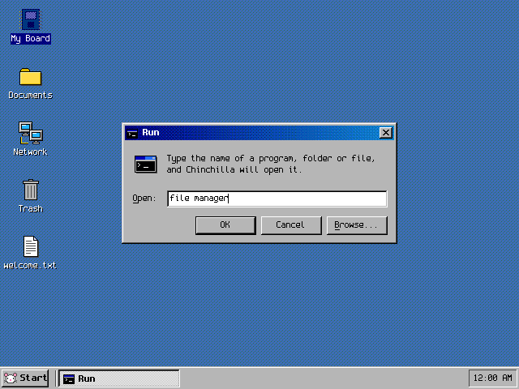

# Run..., and open, run and edit at the prompt

Backlog item 16, the part that does not wait for another item. Branch
`claude/project-thread-8q7ksu`.

## 1. What was asked

The backlog line is "`top`, `dmesg`, `edit`, `open`, `run`, and the Run...
dialog". The Start menu has had a greyed "Run..." since the first desktop.
The owner's instruction for this run of work is "ve haciendo, no pares hasta
terminar el backlog, dejo a tu criterio", so the choices are the agent's and
are marked "to confirm" in `docs/DECISIONS.md`.

`top` needs each process's processor time and memory (item 3), and `dmesg`
needs a log kept in memory that does not exist yet. Both are left for when
there is something for them to show; a `top` that shows only what `ps`
shows would be a second name for `ps`.

## 2. What was found

- The desktop already knows how to start a program by name
  (`shell::find_app`, `launch`) and how to open a file with the program for
  its kind (`open_file`, by extension). Nothing asked it to from typed text.
- The command shell (`core/sh`) knows nothing of the desktop, on purpose:
  the same shell runs in a terminal of the PC and will run on the serial
  port, where there may be no desktop at all.
- A session on a task of its own may not touch windows. It already asks the
  UI task for the process table through `Session::on_ui`.

## 3. The options, and what was chosen

### How the shell reaches the desktop

- **A port, `sh::Desktop`, in the session's environment (chosen)**: open a
  path, run a program, edit a file, and the list of programs. The desktop
  shell gives the Terminal's sessions its own; the PC console gives none,
  and there the commands say "there is no desktop here to open it on". The
  calls are made on the UI task through `on_ui`.
- The shell calls `shell::launch` directly. One line shorter, and the
  shell could no longer be built without the desktop.

### What Run accepts

- **A program's name or a path (chosen)**, as the dialog it is modelled on:
  the name in any case, or the start of it when only one program begins so
  ("term" for the Terminal); a path opens the folder in the File manager or
  the file with its program; a name without a drive is looked for on C:.
  One function, `shell::run_text`, does this for the dialog and for the
  shell's `run`.
- Any command of the shell as well (`dir > list.txt` from Run). It would
  need a session with nowhere to show its output; a Terminal is one click
  further.

### When it cannot be opened

- **The dialog stays (chosen)**, with what was typed, under a message that
  says why: "Cannot find 'x'" or "there is no program for .zip files yet".
- The dialog closes and the message is all that is left. One has to open
  Run again and type the whole thing again to fix a letter.

At the prompt the reason is a line on the terminal, not a message box on
the desktop: whoever typed the command is looking at the terminal.

### What it remembers

The last thing that was run, selected when the dialog opens, so Enter runs
it again and typing replaces it. It is kept in `C:\.config\run.ini`, since
a program keeps nothing in memory while it is closed. A list of earlier
entries (the drop-down of the original) needs a combo box the toolkit does
not have.

### `edit` of a name that is not there

- **It is a new file (chosen)**: `edit notes.txt` makes an empty file and
  opens it, as a console editor does.
- The Editor's "Cannot open" box. Correct, and no help to someone who typed
  the name of the file they want to start.

`edit` opens the desktop's Editor. A console editor, for a serial terminal,
is item 22.

### Whose child

A program started from Run is the desktop's child, not the dialog's: the
dialog is gone a moment later. A program started from a Terminal is also
the desktop's child for now, because the request crosses to the UI task as
a message "to the OS"; it should be the Terminal's, and will be when the
message carries who asked.

## 4. What was built

- `core/src/shell/run.cpp`: `RunDialog` (a program, "Run" in the process
  table while it is open; Alt+O to the field, Browse... through the file
  dialog, Escape), `run_text`, and `SessionDesktop`, the desktop's side of
  `sh::Desktop`.
- `core/src/sh/system.cpp`: `open` (DOS name `start`), `run`, `edit`.
- `shell::has_program_for`, split from `open_file`, so "there is no
  program for it" can be said without a message box.
- Start > Run... is no longer grey.
- Tests: `test_desktop_commands` in `test_sh.cpp` with a made-up desktop
  (paths made whole, names with spaces, every refusal, no desktop);
  `test_run` in `test_terminal.cpp` with the real one (a program by name and
  by the start of its name, a file, a folder, what it remembers, the two
  kinds of failure with the dialog staying, memory back; then `run`,
  `open` and `edit` typed into a Terminal), and `run` from a session on its
  own thread.
- A new reference picture, `47-run`, and four updated: the Start menu's
  Run... is black now, the help screen has three more commands, and a PID in
  the End Task picture moved by one.
- 31 PC tests pass. The firmware compiles and links. **Not run on the
  board.**

## 5. What is left

- `top` (after item 3) and `dmesg` (after there is a log to show).
- A program started from a Terminal as the Terminal's child.
- The title of a folder opened by a typed name shows the name as typed
  ("documents"), not as it is on the disk.
