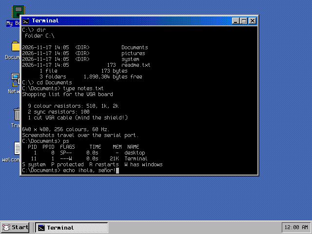

# The Terminal window

2026-11-17. Backlog item 15. Built and tested on the PC only: it opens from
the Start menu there and runs commands. It compiles and links into the
firmware (ESP-IDF v5.5 in the cloud, 1,372,640 bytes with everything); it has
not run on the board.

## 1. What was asked

Third piece of the console, under the same permission as the two before it
([the TTY](2026-11-17-tty.md), [the command shell](2026-11-17-command-shell.md)):

> ve haciendo, no pares hasta terminar el backlog, dejo a tu criterio el orden
> de las tareas y el paralelismo

The backlog line is "Terminal window on the desktop". The architecture review
said what was missing for it: "a terminal widget: a grid of characters that
understands the common escape codes. With the 6x12 font, 80 by 25 characters
is 480 by 300 pixels."

It is the first of the three devices (serial port, telnet, window) to be
built, because it is the only one that needs nothing from the board.

## 2. What was found

- The TTY and the shell (items 12 and 13) were ready and knew nothing about
  windows: the TTY wants a `ports::ByteSink` to show things on and a caller
  for `input()`.
- Programs are made when they open and destroyed when they close since
  item 19, merged the same day (`make_window`, `core/src/shell/internal.hpp`).
  The Editor shows how a program has several copies, each a process.
- The window manager already blinks a caret for the widget that has the
  keyboard (`Widget::caret_rect()`, `caret_shown()`), and gives a widget keys
  first (`key()`) and, for the ones it does not use, the character they type
  (`text()`).
- There is no way for the portable core to start a task. FreeRTOS tasks are
  made in `firmware/os/main/main.cpp`; the browser version has no threads at
  all.
- The mouse wheel does not reach windows yet.

## 3. The options, and what was chosen

### Where the session runs

The decision after the architecture review is "one session is one task".

- **A. A task for each Terminal.** Needs a new port to start and end tasks,
  written for FreeRTOS without a board to try it on, and a second way of
  doing it for the browser, which has no threads. The grid would be written
  by one task and painted by another, so it needs a lock too.
- **B. On the UI task, a line at a time.** When Enter completes a line, the
  window calls the session's `step()`, which runs the command there and then.
  The shell was built with this door (item 13). Nothing new on the board.

Chosen: **B, for now.** It is the same deal the Editor has with its save
today: the desktop waits while a command works. For `dir` and `type` that is
not felt. Its two costs are real and are written here so they are not
forgotten:

- A long command (`cp -r` of a big folder to the flash) freezes the desktop
  until it ends.
- Ctrl+C cannot stop a command that is running in the window, because the
  key cannot arrive while the UI task is busy with the command. It still
  gives up a half-typed line. On the serial console and telnet, which will
  have tasks, Ctrl+C works as tested in item 13.

Both go away when a Terminal's session moves to a task. That belongs with
the port for tasks that jobs (item 10) or apps on their own tasks (item 26)
bring; the window will not need to change, only who calls `step()`.

### How much of a terminal

- **A. A glass teletype**: characters, CR, LF, backspace. Enough for the
  shell as it is, since the TTY redraws lines with nothing else. `cls` would
  not work.
- **B. Those plus a handful of ANSI sequences**: erase the screen, erase to
  the end of the line, place the cursor, move it. What `cls` sends now and
  what `top` and a console editor will send later.
- **C. A full VT100**: scrolling regions, insert and delete, character sets,
  colours. Weeks, for programs that do not exist here.

Chosen: **B**, in `tty::Screen`, 250 lines. Colour sequences are read and
ignored rather than shown as litter.

One thing is done better than a real terminal: a backspace at the start of a
line goes back to the end of the line above. The TTY entry listed "editing a
line longer than the terminal is wide looks wrong" as a known limit on real
terminals; in this window it works, and there is a test that puts a letter
into the middle of a 100-character line.

### The size

80 by 25 in the 6x12 font: 480 by 300 pixels, 484 by 304 with a dark edge,
on a 640 by 480 screen. Fixed. The other option was a window that can be
resized, with the grid following; it needs the grid to re-wrap or cut its
lines and the session to be told. Left for when something asks for it.

### What has scrolled away

- **A. Gone.** With no `more` yet, the top of `help` (20 lines) or of a long
  `dir` could never be read.
- **B. Kept, 175 lines**, 200 with the screen: 16 KB, inside the window's own
  block of memory, so it comes and goes with the window. Page Up and Page
  Down look back a screen at a time; typing returns to the line.
- **C. A scroll bar.** The right thing once the wheel reaches windows.

Chosen: **B**. Scrolling costs nothing: the lines are a ring and only the
number of the top one changes.

### The look

Light grey on black, a block cursor that blinks: a DOS box. When another
window has the keyboard the cursor is a line under the character and does
not blink. The other options were black on white (it would look like the
Editor) and green on black (a terminal from before the 90s). **A matter of
taste, for the owner to overrule.**

The icon is new, drawn here: a small window with a dark screen and `>_`. It
is the agent's drawing, not chosen by the owner from proposals as the others
were (item 29).

### One or several

Up to three at once, each a process and a session of its own, as the Editor
has four. Each costs about 22 KB of external RAM while open.

### Keys

Enter, Backspace, the arrows, Home, End and Delete go in as the bytes a real
terminal sends (`ESC [ A`...), so the TTY cannot tell this window from a
serial terminal. Ctrl and a letter is that letter's control code. Escape is
not sent: in a terminal it starts a sequence, and the TTY would swallow the
next key waiting for the rest.

## 4. What was built

- `core/include/core/tty/screen.hpp`, `core/src/tty/screen.cpp`:
  `tty::Screen`, the grid. It is a `ports::ByteSink`, so the TTY writes
  straight into it. It reports which rows changed, so the window repaints
  those and no more.
- `core/src/shell/terminal.cpp`: the program. `TerminalWindow` holds the
  grid, the TTY and the session; nothing is `static`, all of it is made by
  `make_window` and gone when the window closes. `TerminalView` paints the
  grid (every pixel once: the row with the cursor is drawn in three pieces)
  and turns keys into bytes.
- "Terminal" in Start > Programs, with its icon (`gfx::terminal_icon_16`).
- `exit`, Ctrl+D, the close button and `kill` with its own number all close
  it.
- Small additions to the earlier pieces: `Tty::readable()`,
  `Session::waiting()`, and `cls` no longer leaves an empty line above the
  prompt.

Tested:

- `test_tty` has the grid's tests: text, line ends, tabs, the right edge,
  the escape sequences (also cut in two), 400 lines scrolled through a
  history of 175, looking back and forward.
- `test_terminal` (`ctest` name `terminal`) drives the window with keys: the
  greeting, typing and correcting, the up arrow, Ctrl+C, `type`, a folder
  with "ñ" in its name made and listed, `ps` showing the Terminal itself,
  Page Up through two runs of `help`, three Terminals and a fourth refused,
  and the four ways of closing with the memory counted before and after.
  After each step the screen is compared with a full repaint, which is what
  shows a row that should have been painted and was not.
- Three new reference pictures (`44-terminal`, `45-terminal-commands`,
  `46-terminal-help`), and `08-start-menu-programs` changed for the new
  entry. `34e-end-task-force` changed by two digits: a process number in it
  went up by one because the Terminal scene runs before it.

All 28 PC tests pass, under the address and undefined-behaviour checkers.

Not tested: the board. There it needs a USB keyboard, and two things want
looking at: how long a full-screen scroll takes to paint (25 rows of 80
characters), and how much of the UI task's 16 KB stack a command uses.

## 5. What was learned

- The decision to let the shell be driven in steps, made in item 13 for the
  browser's sake, is what made this item need no board at all.
- `cls` printed the prompt on the second line. The session adds a line end
  before the prompt when the last thing printed did not end one, and the
  escape sequence that clears the screen does not end in a line end.

## 6. What is left

- The session on a task of its own (see "Where the session runs").
- A resizable window, a scroll bar, the wheel, copy and paste with the
  clipboard the Editor has, colours, a bell when sound exists.
- The Run... dialog and `open`, `run`, `edit` (item 16), which make the
  Terminal a way to start programs.
