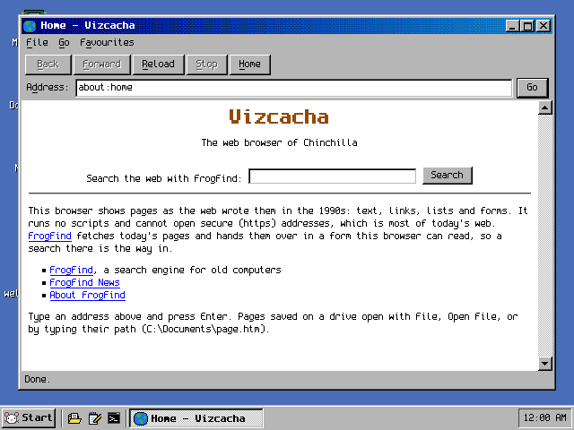
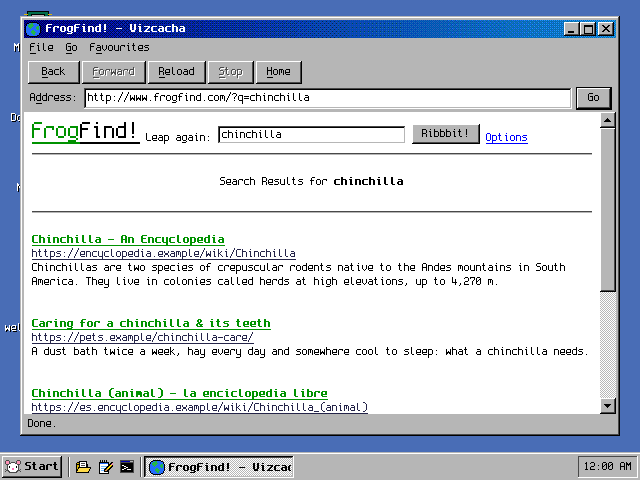

# Vizcacha, a web browser

Backlog item 53 (it was 47 on the branch until main took that number). Branch `claude/project-thread-w6qa7m`. PC only: the firmware
side has not run on the board.

## What was asked

The owner, 2026-11-17:

> I would like to have a basic internet browser that supports básica html
> pages of the era. No JS, no CSS (por not more modern that un that era) the
> benchmark is being a le to load frogfind. Also i want it working con the
> browser build, can the browser simulate a wired internet connection?

And, once the plan was in front of him: "how will this cloudfare worker
work? it's a real tcp oxy?" and "how does this affect the real esp build?".

## What was found

- Chinchilla had only incoming connections: `net::Listener` and `net::Pool`
  for VNC, the web viewer, telnet and updates. Nothing dialled out, and no
  OS call let a program reach a server.
- One fixed font, Spleen 6x12, Latin-1, bold by a wider advance. No
  proportional font and no second size.
- FrogFind (`frogfind.com`, plain HTTP) is a search engine for old computers:
  it searches DuckDuckGo and rewrites today's pages into bare HTML. What it
  sends was fetched and read: `
`, ``, `<form
  method=get>` with one text field `q`, `
`, ` `, `<small>`, lists,
  radio buttons on its options page, one GIF logo. No tables on the pages
  that matter, no scripts, no style sheets.
- FrogFind answers "Internet connection error" (25 bytes) to a request
  whose User-Agent does not look like a browser's. With
  `Mozilla/4.0 (compatible; ...)` it answers normally.
- Its article reader (`/read?a=...`) first shows a page with a "Continue >"
  link, to keep robots out. A person clicks it; the tests do not try to get
  past it.
- A web page cannot open a TCP connection at all, and a page served over
  https may not even `fetch()` a plain-http address (mixed content), nor
  read another site's answer without that site's permission (CORS). So the
  page of Chinchilla cannot reach FrogFind by itself, whatever is simulated.

## The question about the wired connection

Asked: can the browser build simulate a wired internet connection? To the
programs, yes: they see a machine that is on the network, with no Wi-Fi to
set up. But the cable has to end somewhere outside the page, because the
page may not talk to FrogFind. Something on the internet must fetch for it.
Three ways were put to the owner:

| | What it is | Cost | Why not |
| --- | --- | --- | --- |
| **A relay for web requests** (chosen) | A Cloudflare Worker of about 150 lines. The page asks it for an address; it fetches and answers | Free tier, one deploy, no server to keep | |
| A real TCP tunnel | A WebSocket to a server that opens raw connections | The same OS seam, but it is an open TCP proxy on the owner's name: abuse, and more to guard | More than FrogFind needs; can be added later behind the same `net::Dialer` |
| A public CORS proxy | Somebody else's relay | Nothing | They come and go, limit use, and see every page asked for |

The owner chose the Worker relay. It is not a TCP proxy and the answer said
so: it relays web requests. The OS does not know: the seam is a
`net::Dialer`, and the browser writes an HTTP request into what it believes
is a connection. If a real tunnel is ever wanted, only the adapter changes.

On the board nothing of this exists. The board, the simulator and the Linux
program dial with real sockets.

## What was chosen, and by whom

The owner: an HTML browser of the era, no scripts, no style sheets; FrogFind
as the benchmark; it must work in the web page; the Worker relay.

The agent, to be confirmed (they are in `docs/DECISIONS.md`):

- The name, **Vizcacha**: the chinchilla's cousin, the one that goes out.
- **No DOM.** The page is read twice, once to count and once to fill one
  block of memory with a flat list of items (words, breaks, rules, form
  fields), and laid out again when the window's width changes. A tree of
  nodes would be several small allocations per tag, on a machine where the
  page is already a quarter of a megabyte.
- **One font.** Headings are the same letters drawn at twice or three times
  the size (`text_scaled`), bold is the wider advance, italic is slanted by
  shifting rows, `<tt>` and `<pre>` are simply the font. A proportional font
  would look more like 1996 but is a font to draw or license and a text
  measurer to write; it can come later without touching the reader.
- **HTTP/1.0 with a Host line**, `Connection: close`. Every server answers
  it, the end of the page is the end of the connection, and there is no
  keep-alive to manage. Answers of 1.1 are read all the same (a length,
  chunks). Moved sites are followed, five times at most.
- **No TLS.** An https address is refused with a page that says why and
  offers to search for it on FrogFind. mbedTLS is in ESP-IDF, but it is
  some 40 KB of internal RAM per connection and a certificate store, and
  the PC and the web page would each need their own; the sites this browser
  is for are plain http.
- **GET forms only.** A form that posts gets a box that says so. FrogFind
  needs none.
- **Tables are read as rows** (each cell after the other, a break per row),
  frames as links to their pages, pictures as a box with their `alt` text.
  Real tables and pictures were named to the owner as a second round.
- **A page is 256 KB at most**; the rest is not read and the status line
  says the page was cut.
- **Outgoing connections are an OS call**, `os::tcp` (`core/os/tcp.hpp`):
  a connection is a handle, the system knows whose it is and closes it when
  the process ends, four in the machine and two per process. `connect`
  never waits: the dialling (the name lookup can take seconds) runs in a
  background job, and the browser asks from a 30 ms timer how far it is.
- A select box is one line that moves to its next choice on a click: there
  is no drop-down list to draw inside a page.
- The background is white unless the page says otherwise, as Mosaic's
  grey would make the board's 256 colours look dull.

## What was built

- `core/www/url`: addresses. What was typed made into an address, a link
  resolved against its page, `http://host:port/path` taken apart,
  `file:///C:/...` to a path, form values escaped.
- `core/www/html`: the reader and the layout. Entities, UTF-8 and
  Windows-1252 into Latin-1; headings, paragraphs, breaks, rules, centre and
  alignment, bold, italic, underline, strike, `` sizes and colours,
  links, the three kinds of list, `<pre>`, `<blockquote>`, forms with text,
  password, checkbox, radio, select, textarea, submit and hidden fields.
  `<script>` and `<style>` are skipped whole.
- `core/www/http`: `Fetch`, one request at a time, a state machine polled
  from a timer. It talks to a `www::Wire`, which in the system is `os::tcp`
  and in the tests is a script.
- `core/net/dialer.hpp`: the port, `net::Dialer`. `net::PosixDialer`
  (`posix_dialer.hpp`) is the board's (lwIP) and the PC's.
- `core/os/tcp`: the OS calls.
- `core/shell/browser.cpp`: the program. Back, Forward, Reload, Stop, Home;
  an address line; the page with a scroll bar; a status line; history of 16
  pages with where each was scrolled to; Favourites kept in
  `C:\.config\browser.ini`; File > Open File for pages on a drive, and the
  File manager opens `.htm` and `.html` with it; `about:home`, a built-in
  page with a FrogFind search box. It uses only the OS calls (18 of 18 on
  the list of `tools/check_os_calls.py`).
- `host/desktop/web_dialer.hpp`: the web page's Dialer. It reads the request
  the browser wrote, asks the relay with `fetch()`, and hands back the
  answer with HTTP's first lines in front.
- `web/relay/`: the Worker, and how to deploy it (`README.md`). It serves
  only pages from the owner's site, only GET, only public http sites on
  port 80 or 8080, 512 KB at most, and does not follow moved sites itself.
- A globe icon, drawn for this.

## How it was tested

On the PC:

- `test_www`: addresses, the reader, the layout, forms, and the HTTP client
  against scripted servers (lengths, chunks, close, moved sites, https
  refused, a silent server, a page cut at the limit).
- `test_dialer`: `PosixDialer` and `Fetch` over real sockets against a
  server on the same machine; a closed port; a name that does not exist.
- `render_browser_scenes`, ten pictures (`host/tests/pictures/60..69`): the
  home page, a FrogFind-like home, typing a search, results, scrolling, an
  article with lists and a form, the https page, a site not found, a page
  from C:. It also checks which requests went out and that every byte asked
  of the Memory port came back when the window closed.
- FrogFind's own pages (home, a search, news, options, about), fetched once
  through the cloud's proxy, were read with `test_www --dump` and look
  right as text. They are not in the repository.
- The Worker: run in Node with the site faked, 10 cases (allowed, moved,
  too big, wrong origin, https, private address, wrong port, POST).
- The web adapter: `web_dialer.hpp` compiled with Emscripten 3.1.6 and run
  in Node against that Worker: a page, a moved page followed, a dead site.

Not tested, and it matters:

- **Nothing ran on the board.** The firmware compiles and links in the
  cloud container (ESP-IDF v5.5: `esp32-os.bin` is 0x17dde0 bytes, 23% of
  the app partition free). Its change is a `PosixDialer` installed in
  `main.cpp`.
- **The whole web page was not built**: the container cannot download SDL
  for Emscripten. Only the adapter was compiled and run.
- **FrogFind on plain port 80 was never reached from here**: the cloud
  container only goes out through an https proxy. The first real visit is
  the owner's, on Linux or on the board.
- The Worker has not been deployed; that needs the owner's Cloudflare
  account.

## What was learned

- `'\r\n'` inside an `EM_JS` block becomes a real line break in the middle
  of a JavaScript string, because the C preprocessor has the text first.
  The test in Node caught it; the line end is now spelt
  `String.fromCharCode(13, 10)`.
- FrogFind's refusal of unknown User-Agents would have looked like "the
  browser does not work" on the first try. The browser calls itself
  `Mozilla/4.0 (compatible; Vizcacha 1.0; Chinchilla; ESP32-S3)`.
- The board's compiler (GCC 14) refused what the PC's accepted: `visit()`
  copied an address into the history after moving the history's lines, and
  the address could be one of those lines (a favourite never is, but Back
  could have been). It takes a copy first now.
- The desktop moves `C:\docs` to `C:\Documents` at start, which made a test
  page written before start-up vanish.

## What is left

- A board turn: Wi-Fi up, FrogFind opened, a search, `dbg.py misses`, the
  memory given back on close. DNS and connecting run on a job's task with
  8 KB of stack; that figure is a guess until the board says.
- On the Linux desktop program and in the web page there are no tasks, so a
  job runs in the caller: on Linux a slow name lookup holds the desktop
  still for up to 10 seconds. The simulator and the board have tasks.
- The owner deploys the Worker and gives the page its address
  (`web/relay/README.md`).
- Second round, if wanted: pictures (GIF needs a decoder; PNG and JPEG are
  there), real tables, POST, a proportional font, the Network tray icon
  showing a cable in the web page.

## On the board

A board turn the same evening, at 2b130fb with `main` merged in, run by the
board thread. Reported, not merged. Every check passed:

- The gate passed (47 tests), the firmware built and was flashed. Before
  opening: 203,563 bytes of internal RAM free, 6,333,684 external.
- Vizcacha opens on its home page. A search for "chinchilla" brings
  FrogFind's real results (`http://frogfind.com/?q=chinchilla`) in under
  two seconds: the first time the real site was reached on port 80.
- The first result opens, a Wikipedia page as FrogFind rewrites it. No
  "Continue" page appeared. Page Down scrolls; Back twice returns home.
- `https://example.com` shows the page that says the browser cannot
  encrypt.
- `http://no-such-host.invalid/` says no site with that name was found in
  under half a second, and the desktop answered in 3 ms meanwhile.
- After closing, the internal RAM is back to the byte; external is 20
  bytes off. The least external RAM free during use was 6,212,640: about
  121 KB at the peak.
- `tools/dbg.py misses`: none, during and after the page loads.
- The "dial" job never appeared in a reading of the tasks, because it is
  over too soon: there is no figure for its stack yet.

## Brought up to date with main (2026-11-18)

The owner asked for the pull request to be merged as it is, without waiting
for the relay. By then `main` had moved and the branch no longer merged:

- The File manager's kind 3, which the browser used for `.htm`, had become
  "a program in a file" on `main`. Pages are kind 4 now.
- The program table's rows had gained two fields (a task of its own, its
  stack). Vizcacha stays on the UI task, as it was checked on the board; a
  task of its own wants its stack measured first.
- The backlog number 47 had been taken on `main`: the browser is item 53
  (52 went to another branch the same day).
- The three themed Start-menu pictures gained the Vizcacha row.

The PC tests pass (47) and the firmware compiles and links. This merge has
not run on the board.

## A page from the File manager stopped the board (2026-11-18)

The board turn on the merged branch (f6be44c) passed four checks and failed
one: a double click on `C:\Programs\test.htm` (131 bytes) in the File
manager ended in "A stack overflow in task File manager has been detected".
The report is in `C:\crash.txt`.

Why: `open_browser(path)` made the window and read the page where it was
called, and since item 26 the File manager runs on a task of its own. The
page was read, laid out and its address handled on the File manager's
stack, which has no room for that; and Vizcacha, with no task of its own,
would have gone on running on whoever started it. The first board turn did
not see it because it opened the browser from the Start menu, on the UI
task and its 16 KB.

The fix, the one the Picture viewer and the Editor already had:

- `open_browser` hands the opening over with `in_program("Vizcacha", ...)`,
  the path by value (`PathArg`).
- Vizcacha has a task of its own, like every other program now, with 12 KB
  of stack. That figure is a guess: addresses are 600 bytes and several
  lie on the stack at once (a link resolved, a form submitted, a moved
  site). The board measures what is never used and it is trimmed then.

Tested on the simulator, which has program tasks: a page double-clicked in
a File manager window opens in a window that belongs to Vizcacha's process,
and from a desktop icon too. The simulator's stacks are the PC's, so it
cannot show whether 12 KB is enough: only the board can. The PC tests pass
(48) and the firmware compiles and links; this state has not run on the
board.

## On the board, second round (2026-11-18, f9cce0d)

The first try of this round's code (f6be44c) failed: a double-click on a `.htm`
file in the File manager overflowed the File manager task's stack and the
board restarted (`panic, A stack overflow in task File manager`). f9cce0d
gives the browser a task of its own with 12 KB of stack and a page from the
File manager is opened there.

On the board: the home page opens from Start > Programs; a FrogFind search
gives results, a result opens, Page Down runs down a long page, Back twice
returns to the home page; an https address shows the "cannot encrypt" page
and `http://no-such-host.invalid/` the error page. Double-clicking
`C:\Programs\test.htm` in the File manager opens it in Vizcacha and
`hello.app` still runs from the same window. Stacks never used: the
Vizcacha task 4,252 bytes after the page from the File manager and 1,424 at
the lowest (while a Wikipedia page was loaded and scrolled), the File manager
task 5,184. Closing everything returns internal memory exactly and external
memory to 3.9 KB below the figure before (the taskbar's Start menu).
`dbg.py misses`: none.
