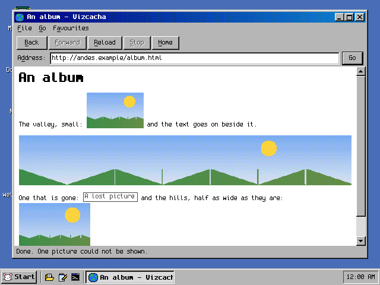

# Pictures in Vizcacha

Follows [Vizcacha, a web browser](2026-11-17-web-browser.md), backlog item 53. Branch `claude/project-thread-w6qa7m`.

## What was asked

The owner, 2026-11-18, with a screenshot of the web version saying "It is not a page but a file of the kind "image/png", which the browser cannot show":

> vizcacha on the browser does not load images
>
> I suspect the worker on cloudflare, but I have not tested on linux nor the board

## What was found

- It was not the Worker. The screenshot shows the relay doing its part: it fetched the PNG and handed it over, and the browser refused it. Vizcacha showed no pictures on any machine: a picture in a page was a box with its `alt` text, and that was named as a second round when the browser was built.
- The same screenshot was the first proof that FrogFind works through the owner's relay in the web version. A test with `curl` minutes before had got a 403 from FrogFind; that was the short browser name in the test command, not a block.
- The system already decodes PNG, JPEG and BMP (`core/image`), a few rows at a time into board colours, for the Picture viewer. Its working memory is one pool of 384 KB from the Memory port. There is no GIF decoder.
- FrogFind hands pictures on as PNG or JPEG through its own address (`/original?i=...`), so they arrive over plain HTTP like its pages.

## The options

Put to the owner on a card:

| | What | Cost |
| --- | --- | --- |
| **Pictures inside pages** (recommended) | PNG, JPEG and BMP fetched and drawn in the page | The browser's work; the decoders exist |
| Only when a picture is opened | A link to a picture shows it alone; pages keep their boxes | Small |
| Inside pages, with GIF | The first, plus a GIF decoder (first frame) | The longest: LZW, palettes, interlacing |
| Leave pictures out | A text browser | Nothing |

The work started on the recommended one before the answer came, as this thread's rule is to keep going; the second option is part of it. The choices below are the agent's, to confirm (`docs/decisions/browser-pictures.md`).

## What was chosen

- **Text first, pictures after, one at a time.** The page is shown as before; then the same 30 ms timer fetches the first picture, decodes it in slices of 8 ms, puts it in the page, and goes to the next. The page can be read and scrolled meanwhile, and Stop stops it. Not several at once: the machine has four outgoing connections and a process two. Not drawn while decoding: every few rows would paint the page again.
- **The page makes room when a picture comes.** With `width` and `height` in the page the box already has the size and nothing moves. Without, the lines below move down; the words at the top of the view stay where they are.
- **Size**: what the page says, or the picture's own; with only a width, the height in proportion. Never larger than the picture (the converter only shrinks), never wider than the page, 2000 rows at most.
- **Stored as board colours**, a byte a pixel, dithered once with Floyd-Steinberg (the Picture viewer's default). Scrolling copies them; nothing is decoded twice.
- **Limits**, each marked `ponytail` in the code: 24 pictures a page, 1.5 MB of pixels in all, 256 KB a picture's file (the fetch's limit for a page). What is over keeps its box, and the status line says how many could not be shown.
- **A picture opened by itself** (a link to one, as in the owner's screenshot) becomes a page of one picture, decoded from the bytes already fetched.
- **No cache.** Back fetches the pictures again.
- **GIF stays a box.** FrogFind's own logo is one, so its home page still shows a box there.

## What was built

- `www::Document`: a picture's place takes the size of the picture that came (`set_picture_size`), at the next layout.
- `core/src/shell/browser.cpp`: a second `Fetch` for pictures, the decoder and the converter of `core/image`, the list of pictures that have come, and their drawing. Pictures beside a page on a drive are read from the drive.
- Nothing changed in the relay: it already passed any kind of file.

## How it was tested

On the PC. `render_browser_scenes` has four new pictures (`host/tests/pictures/70..73`): a page with a picture at the size the page gives inside a link, one wider than the page made to fit, one that is not there, one with only a width; the wide one opened by itself through the link; a page on C: with a picture beside it. It checks the order the pictures were asked for, that no connection stays open, and that every byte comes back when the window closes. FrogFind's home in the tests now asks for its logo and keeps the box. The test pictures are BMPs made in the test; PNG and JPEG go through the same decoder, which has its own tests.

All 52 PC tests pass and the firmware compiles and links. **Not run on the board, and not in a real browser page.** The largest frames on the browser's task are still under 1.1 KB (`-fstack-usage`), but decoding now runs on that task: its unused stack wants reading again on the board.

## What is left

- A board turn: a FrogFind article with pictures, memory before and after, the task's stack, `dbg.py misses` while a picture decodes.
- The owner's answer to the card. If GIF is wanted, it is the next piece.

## The owner's answer

The same evening, on the card: "Pictures inside pages". GIF is not part of it for now.

