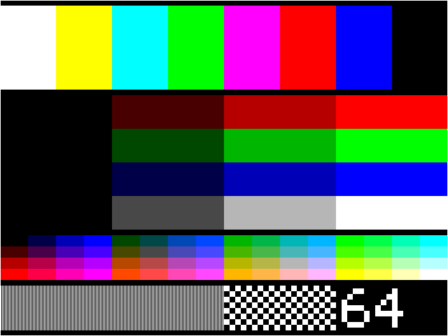
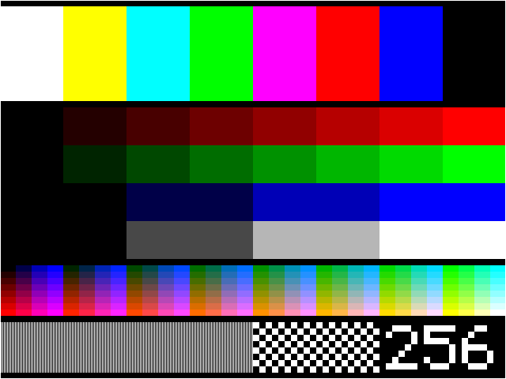

# VGA test

Checks the VGA adapter wiring. It outputs 640x480 at 60 Hz and shows a test
card, switching every 10 seconds between the 64-colour and the 256-colour
version.

## Build and flash

Needs ESP-IDF v5.5. Plug the computer into the USB-C socket marked UART (or
COM).

```sh
idf.py set-target esp32s3
idf.py -p <serial port> flash monitor
```

To build on GitHub instead, copy `ci/github-build-workflow.yml` to
`.github/workflows/build.yml`. Each run then uploads `vga-test-merged.bin`,
which can be flashed with [esptool](https://docs.espressif.com/projects/esptool/)
alone:

```sh
esptool.py --chip esp32s3 -p <serial port> write_flash 0x0 vga-test-merged.bin
```

Then open a serial terminal at 115200 baud.

## Keys

| Key | Action |
| --- | --- |
| `1` | Show the 64-colour card and stay there |
| `2` | Show the 256-colour card and stay there |
| `a` | Auto: switch between the two every 10 seconds (default) |
| `c` | Try the next pixel clock: 25.175, 25, 24, 26.67 MHz |
| `r` | Restart the video output |
| `i` | Print status |
| `h` | Help |

## What to look for

Expected picture, as computed from the same drawing code on a PC:

| 64 colours | 256 colours |
| --- | --- |
|  |  |

From top to bottom the card shows:

1. A one-pixel white frame. All four edges should be visible. If one is cut
   off, use the monitor's auto-adjust.
2. Eight colour bars: white, yellow, cyan, green, magenta, red, blue, black.
   A wrong or missing colour points to a swapped or open colour line.
3. Red and green ramps with 8 steps and a blue ramp with 4. Each step should
   be brighter than the one to its left. Two equal steps, or a step that gets
   darker, point to a wrong resistor value or two swapped pins of one colour.
4. Four greys. They should have no colour tint. A tint here means the blue
   mirror pin (GPIO8) is not working or blue's resistors are wrong.
5. Every colour of the mode: 256 small cells, or 64 larger ones.
6. Single-pixel vertical lines, a checkerboard, and the mode as a number. The
   lines should be even, without shimmer. If they shimmer, try another pixel
   clock with `c`.

Both cards use one byte per pixel on the same wiring. The 64-colour card only
uses the colours where each of red, green and blue has two bits.

## If there is no picture

- Check HSYNC (GPIO9) and VSYNC (GPIO10) reach connector pins 13 and 14, and
  that ground is connected.
- Press `c` to try the other pixel clocks.
- If the picture drifts sideways or tears, set `VGA_BOUNCE_PX` to `10 * H_RES`
  in `main/vga_test.c` and rebuild.

## No picture: checks with a multimeter

Press `w` for a whole white screen, then measure DC volts against GND:

| Where | Expected | Meaning if different |
| --- | --- | --- |
| GPIO9 (HSYNC) at the ESP32 pin | about 2.9 V (31.5 kHz if the meter reads frequency) | 3.3 V or 0 V: the firmware is not producing video |
| GPIO10 (VSYNC) at the ESP32 pin | about 3.3 V (60 Hz if the meter reads frequency) | 0 V: no video |
| GPIO4 (red top bit) at the ESP32 pin | about 2.4 V | 3.3 V: colour is not blanked between lines; 0 V: no data |
| Red, green, blue at the VGA plug, adapter connected | about 0.5 V | 0 V: break between the resistors and the plug |
| HSYNC (pin 13) at the VGA plug | about 2.9 V | wire mapped to the wrong pin |
| ESP32 GND to the metal shell of the VGA plug | continuity | no shared ground |
