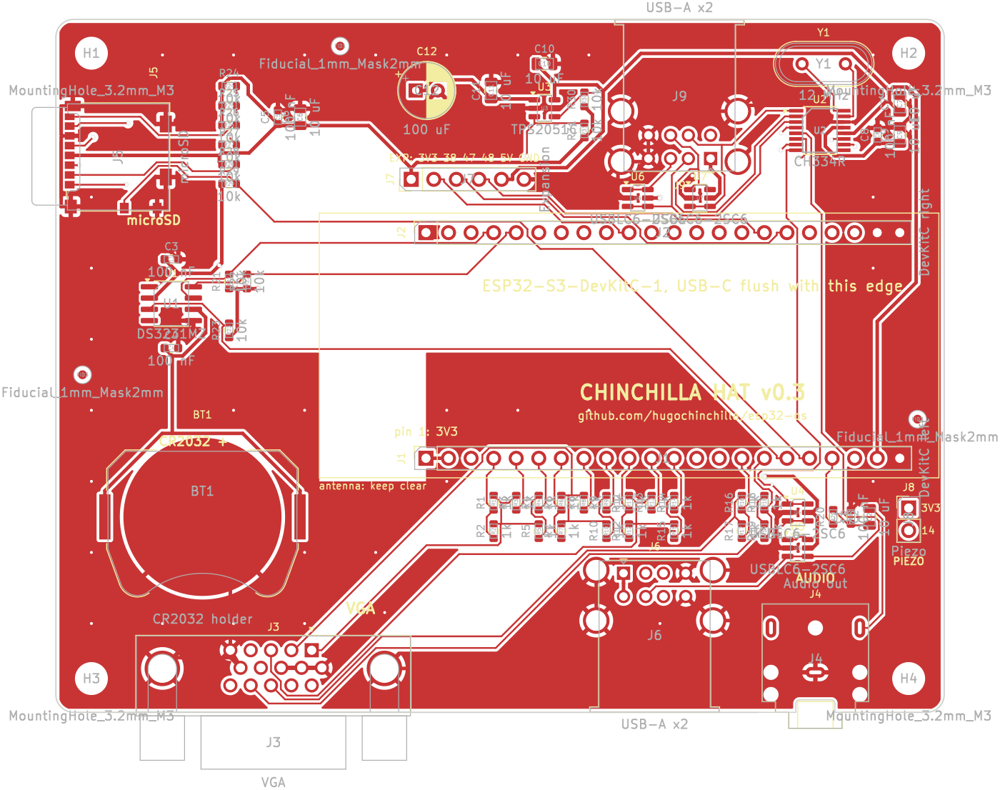
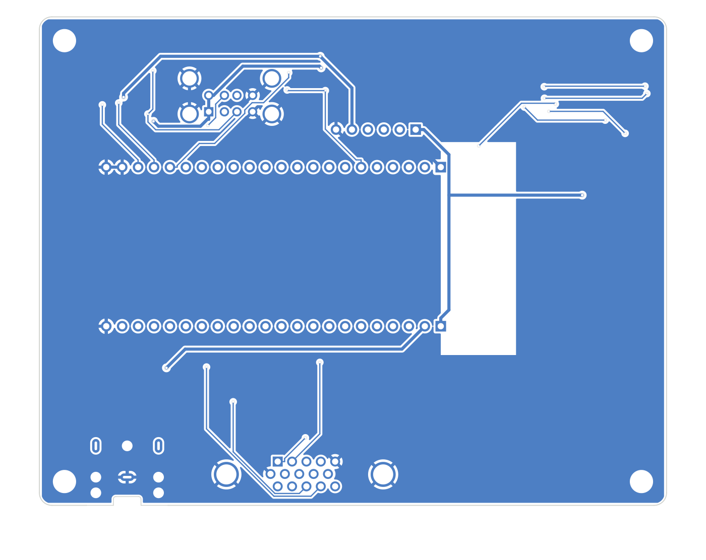

# Chinchilla hat v0.1 (prototype PCB)

A two-layer, 100 x 78 mm board that the ESP32-S3-DevKitC-1 plugs into. It
replaces the hand-built perfboard adapter and adds the extras Hugo chose on
2026-11-16:

- VGA: 3-bit resistor ladders per colour (510 ohm, 1 k, 2 k, 1 %), 100 ohm on
  each sync line, HD15 socket on the board edge. Same pins and values as
  [the perfboard adapter](../../docs/hardware/README.md).
- Audio out (1 k + 100 nF filter, 10 uF DC block, 10 k bleeder) to a 3.5 mm
  jack, and a piezo sounder between 3V3 and GPIO14.
- Clock chip DS3231MZ on I2C (GPIO1 SDA, GPIO2 SCL), alarm/1 Hz output on
  GPIO11, CR2032 holder.
- microSD socket wired for 1-bit SDMMC (CLK 39, CMD 40, D0 41), all data
  lines pulled up, card detect switch on GPIO12.
- USB host through a CH334R hub with two USB-A sockets for keyboard and mouse.
  Port power goes through a TPS2051C current-limited switch: on by default,
  GPIO21 low turns it off, GPIO42 reads its overcurrent flag. ESD protection
  (USBLC6-2SC6) on both ports. Bus powered from the dev board's 5V pin.
- A 6-pin expansion header (3V3, GPIO38, 47, 48, 5V, GND), not fitted.

**Status: routed, passes KiCad's design rule check (no errors; only
silkscreen-at-edge warnings from the connector outlines), not built.** Treat
the first order as a test run of one to three boards.

| Top (copper and silkscreen) | Bottom (copper, seen from below) |
| --- | --- |
|  |  |

## Files

| File | What it is |
| --- | --- |
| `hat.kicad_pro`, `hat.kicad_sch`, `hat.kicad_pcb` | KiCad project (saved by KiCad 7; KiCad 8 and 9 open it and convert it) |
| `hat.kicad_sym`, `sym-lib-table` | The board's own symbols (dev board sockets, connectors) |
| `fab/hat-gerbers.zip` | Gerbers and Excellon drill files, for any board maker |
| `fab/hat-bom.csv` | Bill of materials with manufacturer part numbers |
| `fab/hat-pos-top.csv` | Pick-and-place (component positions), top side |
| `fab/hat-schematic.pdf`, `fab/hat-assembly-top.pdf` | Schematic and assembly drawing |

Tracks are 0.25 mm (0.5 mm for power), clearance 0.2 mm, vias 0.6/0.3 mm,
so any standard two-layer process can make it. The tracks were laid by
Freerouting 1.9 (`build/hat.dsn` in, `build/hat.ses` out) and imported by
`gen_pcb.py`; `REROUTE=1 FREEROUTING_JAR=... python3 tools/hat_pcb/gen_pcb.py
route` routes again after a placement change (needs Java and `xvfb-run`).
Placement coordinates in `hat-pos-top.csv` are from the board's bottom-left
corner.

Everything is generated from one parts table by the scripts in
`tools/hat_pcb/` (`parts.py` is the netlist and BOM; `gen_sch.py`,
`gen_pcb.py` and `gen_outputs.py` write the files). Change `parts.py` and run
them again rather than editing the netlist by hand in two places. The
schematic netlist is checked against `parts.py` when it is generated. Once
the board is edited by hand in KiCad, the KiCad files become the source and
the scripts should be retired.

## Layout

- Dev board on top, in two 1x22 sockets 25.4 mm apart (10 holes on the
  perfboard, which fits the board in use). Its USB-C sockets face the right
  edge, its antenna end the left, with no copper pour under the antenna.
- VGA and audio jack on the bottom edge, USB-A on the top edge, microSD on the
  left edge.
- Ground: a pour on both layers. The VGA socket's five ground pins and both
  shell lugs go to it (on the perfboard, pin 10 alone gave no picture).
- Parts on the top side only; through-hole parts are the two sockets, the VGA
  socket, the jack and the USB-A socket.

## Before ordering

1. Check the header spacing of your dev board (25.4 mm between the two rows)
   and that pin 1 (3V3) is at the antenna end.
2. Upload the project and look at the assembler's 3D / placement preview,
   especially the polarity of U1 to U5 and the orientation of the microSD
   socket, VGA socket and jack.
3. The VGA socket footprint is a generic KiCad one (Tonar/Amphenol style,
   pins 3.03 mm from the edge). If the assembler offers a different HD15
   part, compare its drawing with the footprint.
4. The coin cell is not fitted by the assembler; insert a CR2032.

## Firmware notes

- Pins newly used: GPIO11 (clock chip alarm, open drain, pulled up) and
  GPIO12 (card detect, low when a card is inserted). Both were spare.
- Leave GPIO21 high or floating to keep USB power on (R23 pulls it up).
- The hub is a standard USB hub. ESP-IDF 5.5's USB host library supports
  external hubs behind `CONFIG_USB_HOST_HUBS_SUPPORTED` (marked
  experimental); check this before relying on it.

## Where to order in Europe

Prices checked 2026-11-16 where the maker publishes them; others are rough
estimates and say so. All take a KiCad project or Gerbers plus BOM and
pick-and-place, which is what `fab/` holds.

| Maker | Where | Minimum | Lead time | Files | Price |
| --- | --- | --- | --- | --- | --- |
| [AISLER](https://aisler.net/products/assembly) | Germany | 1 assembled board (bare boards in sets of 3) | 6 business days (Blitz); about 9 with part buying | Native KiCad project upload, BOM built automatically; Gerbers also accepted | Instant price on upload. Bare boards: EUR 12 + EUR 0.067/cm² per board, so 3 of these 78 cm² boards are about EUR 28 + VAT. Assembly fee and parts on top. Free shipping |
| [Eurocircuits](https://www.eurocircuits.com/pcb-assembly-proto/) | Belgium (plants in BE, DE, HU) | 1 board (PCB Proto: 1 to 5) | 6 working days assembled (3 + 3), faster options | Gerber/ODB++ plus BOM and CPL, data checked in their visualiser | Online calculator, no published examples; no minimum charge or tooling cost. My estimate: the dearest of the three for one-offs |
| [Beta Layout / PCB-POOL](https://eu.beta-layout.com/pcb/) | Germany / Ireland | 1 board (assembly of 1 to 50) | Boards from 8 h; assembly time in the configurator | Gerbers; other formats on their file format page | Configurator or quote |
| For comparison: [JLCPCB](https://jlcpcb.com/news/eu-customs-reform-2026) | China, ships to the EU | 2 assembled boards | About 1 to 2 weeks with shipping | Gerbers + BOM + CPL (the files in `fab/`) | Usually the cheapest. Since 1 July 2026 every EU parcel pays duty: EUR 3 per item category for private orders under EUR 150, plus VAT and a possible carrier fee |

### Estimated cost of assembled boards

Rough estimates made on 2026-11-16 for this board (78 cm², two layers,
23 different parts, about 45 SMD and 5 through-hole parts), before VAT and
before any quote. Upload the files for real numbers; treat these as the order
of magnitude.

Parts cost about EUR 30 per board at distributor single-unit prices. The
DS3231MZ (about EUR 7), the five connectors and the two sockets are most of it.

| | 1 board | 3 boards | 5 boards |
| --- | --- | --- | --- |
| AISLER | about EUR 245 | about EUR 310 | about EUR 390 (6 boards, sold in sets of 3) |
| JLCPCB (economic assembly, minimum 2) | about EUR 90 (for 2) | about EUR 115 | about EUR 145 |
| Eurocircuits | about EUR 400 to 600 for 1 to 2 boards; my guess, no published fees | | |

How they were worked out:

- **AISLER.** Their last published assembly fees (May 2022, may have
  changed) are EUR 7.50 per different part, EUR 0.04 per placed SMD part and
  EUR 0.01 per cm² per board. With 23 different parts the per-part fee
  (about EUR 172) is most of the bill and does not grow with quantity. Add
  bare boards (EUR 12 + EUR 0.067/cm² per board, in sets of 3, about EUR 28
  for 3), a stencil (EUR 5 + EUR 0.095/cm², about EUR 12), parts and free
  shipping. Through-hole soldering prices are not published and are left out.
  Soldering the five through-hole parts yourself removes 5 different parts
  (about EUR 37) plus their soldering charge.
  ([fees](https://community.aisler.net/t/amazing-assembly-gets-radical-price-cuts/905),
  [boards and stencil](https://community.aisler.net/t/our-simple-pricing/102))
- **JLCPCB.** Economic assembly: about $8 setup, $1.50 stencil, $3 for each
  "extended" part type (about 8 here), $0.0164 per hand-soldered joint plus a
  $3.58 hand-soldering charge (about 76 joints), boards about $5, parts about
  $20 per board at LCSC prices, DHL to Spain about $20 to 25. Some parts
  (the Würth USB-A, Keystone holder, Amphenol VGA socket) may need LCSC
  equivalents. On delivery add VAT and, since 1 July 2026, EUR 3 duty per item
  category plus the carrier's handling fee, about EUR 25 to 40 in total.
  ([fees](https://jlcpcb.com/help/article/pcb-assembly-price),
  [EU duty](https://jlcpcb.com/news/eu-customs-reform-2026))
- **Eurocircuits.** Their 3-day PCB Proto price for two bare 100 x 80 mm
  boards was EUR 168 in October 2026
  ([comparison](https://deltaproto.com/pcb-assembly-netherlands-compared));
  assembly and parts come on top. Use their calculator before deciding.

Recommendation: **AISLER**. It is in Germany, takes the KiCad project
directly and shows a price before you pay, builds a single board, and buys
parts from LCSC, Mouser, Digi-Key, Farnell and others, so the CH334R (an LCSC
part) is available. ([parts sources](https://community.aisler.net/t/component-procurement-capabilities/2464),
[pricing](https://community.aisler.net/t/our-simple-pricing/102))

Multi-CB (Germany) makes bare boards and stencils quickly and imports KiCad
files, but assembly goes through a separate quote, so it suits a self-solder
build better.
