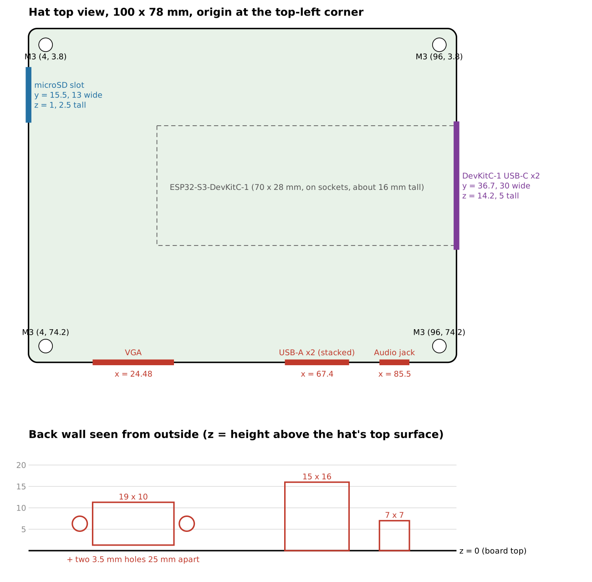

# Chinchilla hat v0.3 (prototype PCB)

A two-layer, 100 x 78 mm board that the ESP32-S3-DevKitC-1 plugs into. It
replaces the hand-built perfboard adapter and adds the extras Hugo chose on
2026-11-16. It is laid out for **partial assembly** (level B below): the
board maker places only 8 different SMD parts, and everything that is quick
to solder by hand is left to you. Version 0.3 puts every socket at a board
edge, facing outwards, so the board fits a 3D-printed case with cut-outs in
the walls (see [Enclosure](#enclosure)).

- VGA: 3-bit resistor ladders built from 1 k resistors only. Top bit: two 1 k
  in parallel (500 ohm); middle bit: one 1 k; low bit: two 1 k in series
  (2 k). Exact 1:2:4 steps, 0.69 V into 75 ohm at full white (the perfboard's
  510 / 1 k / 2 k gives 0.68 V). Sync lines through two 1 k in parallel
  (500 ohm instead of 100). Same pins as
  [the perfboard adapter](../../docs/hardware/README.md).
- Audio out (1 k + 100 nF filter, 10 uF DC block) to a through-hole 3.5 mm
  jack on the back edge, and a 2-pin header for a piezo between 3V3 and
  GPIO14.
- Clock chip DS3231MZ on I2C (GPIO1 SDA, GPIO2 SCL), alarm/1 Hz output on
  GPIO11, CR2032 holder.
- microSD socket wired for 1-bit SDMMC (CLK 39, CMD 40, D0 41), all data
  lines pulled up, card detect switch on GPIO12.
- USB host through a CH334R hub (through-hole 12 MHz crystal) with two USB-A
  sockets for keyboard and mouse. Port power goes through a TPS2051C
  current-limited switch: on by default, GPIO21 low turns it off, GPIO42
  reads its overcurrent flag. ESD protection (USBLC6-2SC6) on both ports,
  100 uF electrolytic on port power. Bus powered from the dev board's 5V pin.
- A 6-pin expansion header (3V3, GPIO38, 47, 48, 5V, GND), not fitted.

Only two resistor values (1 k, 10 k) and two capacitor values (100 nF,
10 uF). Pull-ups stay at 10 k because the SD card specification asks for
10 k to 100 k.

### Who fits what

| Board maker (SMD, 8 different parts, 47 placements) | You (hand soldering) |
| --- | --- |
| 1 k and 10 k resistors, 100 nF and 10 uF capacitors (0603 / 0805) | Two 1x22 sockets for the dev board |
| CH334R hub (QSOP-16, 0.635 mm pitch) | HD15 VGA socket, stacked USB-A socket |
| DS3231MZ clock (SOIC-8) | microSD socket (SMD, 1.1 mm pitch) and CR2032 holder (SMD, big pads) |
| TPS2051C power switch, 2x USBLC6-2SC6 | 12 MHz HC-49 crystal, 100 uF electrolytic, 3.5 mm jack, 2-pin piezo header |

The lists are `fab/hat-bom-assembly.csv` (send to the maker) and
`fab/hat-hand-solder.csv` (buy yourself). `fab/hat-pos-top.csv` holds only the
maker's parts.

**Status: routed, passes KiCad's design rule check (no errors and no
unconnected pads; only silkscreen warnings, mostly connector outlines at the
board edge), not built.** Treat
the first order as a test run of one to three boards.

| Top (copper and silkscreen) | Bottom (copper, seen from below) |
| --- | --- |
|  |  |

## Files

| File | What it is |
| --- | --- |
| `hat.kicad_pro`, `hat.kicad_sch`, `hat.kicad_pcb` | KiCad project (saved by KiCad 7; KiCad 8 and 9 open it and convert it) |
| `hat.kicad_sym`, `sym-lib-table` | The board's own symbols (dev board sockets, connectors) |
| `fab/hat-gerbers.zip` | Gerbers and Excellon drill files, for any board maker |
| `fab/hat-bom.csv` | Full bill of materials, with who fits each part |
| `fab/hat-bom-assembly.csv` | The board maker's part of the BOM |
| `fab/hat-hand-solder.csv` | Parts you buy and solder |
| `fab/hat-pos-top.csv` | Pick-and-place for the board maker's parts, top side |
| `fab/hat-schematic.pdf`, `fab/hat-assembly-top.pdf` | Schematic and assembly drawing |
| `enclosure.png`, `enclosure.svg`, `enclosure-cutouts.csv` | Case reference: outline, M3 holes, wall cut-outs |

Tracks are 0.25 mm (0.4 mm for power), clearance 0.2 mm, vias 0.6/0.3 mm,
so any standard two-layer process can make it. The tracks were laid by
Freerouting 1.9 (`build/hat.dsn` in, `build/hat.ses` out) and imported by
`gen_pcb.py`; `REROUTE=1 FREEROUTING_JAR=... python3 tools/hat_pcb/gen_pcb.py
route` routes again after a placement change (needs Java and `xvfb-run`).
Placement coordinates in `hat-pos-top.csv` are from the board's bottom-left
corner.

Everything is generated from one parts table by the scripts in
`tools/hat_pcb/` (`parts.py` is the netlist and BOM; `gen_sch.py`,
`gen_pcb.py`, `gen_outputs.py` and `gen_enclosure.py` write the files). Change `parts.py` and run
them again rather than editing the netlist by hand in two places. The
schematic netlist is checked against `parts.py` when it is generated. Once
the board is edited by hand in KiCad, the KiCad files become the source and
the scripts should be retired.

## Layout

- Dev board on top, in two 1x22 sockets 25.4 mm apart (10 holes on the
  perfboard, which fits the board in use). Its USB-C sockets line up with the
  right edge, its antenna end points left, with no copper pour under the
  antenna.
- Back (bottom) edge: VGA at the left end, the stacked USB-A pair and the
  audio jack, all right-angle parts with their fronts at the edge. About
  22 mm of free wall between the VGA's right screw post and the USB-A
  socket, so a bulky VGA plug fits and its thumbscrews can be turned. The
  coin cell sits just above the VGA socket. Left edge: microSD. Right
  edge: the dev board's two USB-C sockets. The piezo header sits inside.
- Ground: a pour on both layers. The VGA socket's five ground pins and both
  shell lugs go to it (on the perfboard, pin 10 alone gave no picture).
- Parts on the top side only.

## Before ordering

1. Check the header spacing of your dev board (25.4 mm between the two rows)
   and that pin 1 (3V3) is at the antenna end. Measure the distance from the
   centre of pin 22 (GND, the last pin at the USB end) to the front of the
   USB-C sockets. The layout assumes 5.0 mm (`DEVKIT_USB_OVERHANG` in
   `gen_pcb.py`, estimated from the board's 70 mm length), so that the
   sockets end flush with the board's right edge. If yours differs, change
   the value and re-run the scripts.
2. Upload the project and look at the assembler's 3D / placement preview,
   especially the polarity of U1 to U5. If the maker builds its BOM from the
   KiCad project (AISLER does), mark the hand-solder parts (J1 to J8, BT1,
   Y1, C12) as "do not place" there; they are already left out of
   `hat-pos-top.csv`.
3. The VGA socket footprint is a generic KiCad one (Tonar/Amphenol style,
   pins 3.03 mm from the edge). If the assembler offers a different HD15
   part, compare its drawing with the footprint.
4. Sync now goes through 500 ohm instead of the perfboard's 100 ohm. If your
   VGA-to-HDMI adapter shows no picture, solder a 1 k across each sync pair
   (R16/R17 and R18/R19) to bring it to about 330 ohm, or bridge them.
5. Solder the low parts first (microSD socket, coin cell holder), then the
   crystal, headers and capacitor, then the sockets and connectors.

## Enclosure

The board is meant to sit on four M3 standoffs inside a printed case, with
openings in three walls. Coordinates are in mm from the board's top-left
corner (as in the drawing); heights are above the board's top surface.

| Wall | Opening | Centre | Size (w x h) | Centre height |
| --- | --- | --- | --- | --- |
| Back | VGA D shell, plus two 3.5 mm holes 25 mm apart for the screw posts | x = 24.5 | 19 x 10 | 6.3 |
| Back | Stacked USB-A pair | x = 67.4 | 15 x 16 | 7.8 |
| Back | Audio jack | x = 85.5 | 7 x 7 | 3.0 |
| Left | microSD slot (the card sticks out about 2.5 mm) | y = 15.5 | 13 x 2.5 | 1.0 |
| Right | Dev board USB-C pair, one slot for both | y = 36.7 | 30 x 5 | 14.2 |

- Board 100 x 78 mm, 1.6 mm thick, 2 mm corner radius. M3 holes at
  (4, 3.8), (96, 3.8), (4, 74.2) and (96, 74.2).
- The tallest parts are the dev board on its sockets (about 16 mm) and the
  USB-A pair (about 16 mm), so allow at least 18 mm of inside height above
  the board, and 4 mm standoffs below it for the through-hole leads.
- The VGA, USB-A and jack fronts are at the board edge. A wall up to about
  2 mm thick works for all three; the VGA shell sticks out about 7 mm, so a
  thicker wall is fine there.
- The heights come from typical datasheet values and the usual socket stack
  (8.5 mm socket plus 2.5 mm header plastic under the dev board). Check them
  with real parts before printing, and print a test strip of the back wall
  first.
- `tools/hat_pcb/gen_enclosure.py` redraws this from the board file if the
  layout changes.

## Firmware notes

- Pins newly used: GPIO11 (clock chip alarm, open drain, pulled up) and
  GPIO12 (card detect, low when a card is inserted). Both were spare.
- Leave GPIO21 high or floating to keep USB power on (R30 pulls it up).
- The hub is a standard USB hub. ESP-IDF 5.5's USB host library supports
  external hubs behind `CONFIG_USB_HOST_HUBS_SUPPORTED` (marked
  experimental); check this before relying on it.

## Where to order in Europe

Prices checked 2026-11-16 where the maker publishes them; others are rough
estimates and say so. All take a KiCad project or Gerbers plus BOM and
pick-and-place, which is what `fab/` holds.

| Maker | Where | Minimum | Lead time | Files | Price |
| --- | --- | --- | --- | --- | --- |
| [AISLER](https://aisler.net/products/assembly) | Germany | 1 assembled board (bare boards in sets of 3) | 6 business days (Blitz); about 9 with part buying | Native KiCad project upload, BOM built automatically; Gerbers also accepted | Instant price on upload. Bare boards: EUR 12 + EUR 0.067/cm² per board, so 3 of these 78 cm² boards are about EUR 28 + VAT. Assembly fee and parts on top. Free shipping |
| [Eurocircuits](https://www.eurocircuits.com/pcb-assembly-proto/) | Belgium (plants in BE, DE, HU) | 1 board (PCB Proto: 1 to 5) | 6 working days assembled (3 + 3), faster options | Gerber/ODB++ plus BOM and CPL, data checked in their visualiser | Online calculator, no published examples; no minimum charge or tooling cost. My estimate: the dearest of the three for one-offs |
| [Beta Layout / PCB-POOL](https://eu.beta-layout.com/pcb/) | Germany / Ireland | 1 board (assembly of 1 to 50) | Boards from 8 h; assembly time in the configurator | Gerbers; other formats on their file format page | Configurator or quote |
| For comparison: [JLCPCB](https://jlcpcb.com/news/eu-customs-reform-2026) | China, ships to the EU | 2 assembled boards | About 1 to 2 weeks with shipping | Gerbers + BOM + CPL (the files in `fab/`) | Usually the cheapest. Since 1 July 2026 every EU parcel pays duty: EUR 3 per item category for private orders under EUR 150, plus VAT and a possible carrier fee |

### Estimated cost by assembly level

Rough estimates made on 2026-11-16, before VAT and before any quote, from
AISLER's last published fees (see below). The design in this folder is
level B. Levels C and D need small changes to the board (a through-hole fuse
instead of the switch, no ESD chips).

| Level | Board maker places | Different parts | 1 board | 3 boards | 6 boards | Your parts for 3 boards |
| --- | --- | --- | --- | --- | --- | --- |
| A (v0.1) | Everything | 23 | EUR 245 | EUR 310 | EUR 390 | none |
| **B (v0.2)** | Resistors, capacitors, hub, clock chip, power switch, ESD | 8 | EUR 115 | EUR 140 | EUR 200 | about EUR 50 |
| C | As B, without switch and ESD (you fit a through-hole fuse) | 6 | EUR 95 | EUR 120 | EUR 170 | about EUR 50 |
| D | As C, and you also solder the clock chip | 5 | EUR 80 | EUR 90 | EUR 120 | about EUR 70 |
| E | Nothing: bare boards and stencil | 0 | EUR 40 | EUR 40 | EUR 55 | about EUR 80 |

For comparison, JLCPCB at level B (four "extended" parts at $3, the rest
basic) comes to about EUR 85 for 2 boards and EUR 100 for 5 including the EU
import costs, so the gap to a German maker mostly closes. At level A it was
about EUR 115 for 3 against AISLER's EUR 310.

How they were worked out:

- **AISLER.** Their last published assembly fees (May 2022, may have
  changed) are EUR 7.50 per different part, EUR 0.04 per placed SMD part and
  EUR 0.01 per cm² per board. The per-part fee does not grow with
  quantity, which is why fewer different parts matter more than fewer parts. Add
  bare boards (EUR 12 + EUR 0.067/cm² per board, in sets of 3, about EUR 28
  for 3), a stencil (EUR 5 + EUR 0.095/cm², about EUR 12), parts and free
  shipping. Through-hole soldering prices are not published and are left out.
  Soldering the five through-hole parts yourself removes 5 different parts
  (about EUR 37) plus their soldering charge.
  ([fees](https://community.aisler.net/t/amazing-assembly-gets-radical-price-cuts/905),
  [boards and stencil](https://community.aisler.net/t/our-simple-pricing/102))
- **JLCPCB.** Economic assembly: about $8 setup, $1.50 stencil, $3 for each
  "extended" part type (about 8 here), $0.0164 per hand-soldered joint plus a
  $3.58 hand-soldering charge (about 76 joints), boards about $5, parts about
  $20 per board at LCSC prices, DHL to Spain about $20 to 25. Some parts
  (the Würth USB-A, Keystone holder, Amphenol VGA socket) may need LCSC
  equivalents. On delivery add VAT and, since 1 July 2026, EUR 3 duty per item
  category plus the carrier's handling fee, about EUR 25 to 40 in total.
  ([fees](https://jlcpcb.com/help/article/pcb-assembly-price),
  [EU duty](https://jlcpcb.com/news/eu-customs-reform-2026))
- **Eurocircuits.** Their 3-day PCB Proto price for two bare 100 x 80 mm
  boards was EUR 168 in October 2026
  ([comparison](https://deltaproto.com/pcb-assembly-netherlands-compared));
  assembly and parts come on top. Use their calculator before deciding.

Recommendation: **AISLER**. It is in Germany, takes the KiCad project
directly and shows a price before you pay, builds a single board, and buys
parts from LCSC, Mouser, Digi-Key, Farnell and others, so the CH334R (an LCSC
part) is available. ([parts sources](https://community.aisler.net/t/component-procurement-capabilities/2464),
[pricing](https://community.aisler.net/t/our-simple-pricing/102))

Multi-CB (Germany) makes bare boards and stencils quickly and imports KiCad
files, but assembly goes through a separate quote, so it suits a self-solder
build better.
